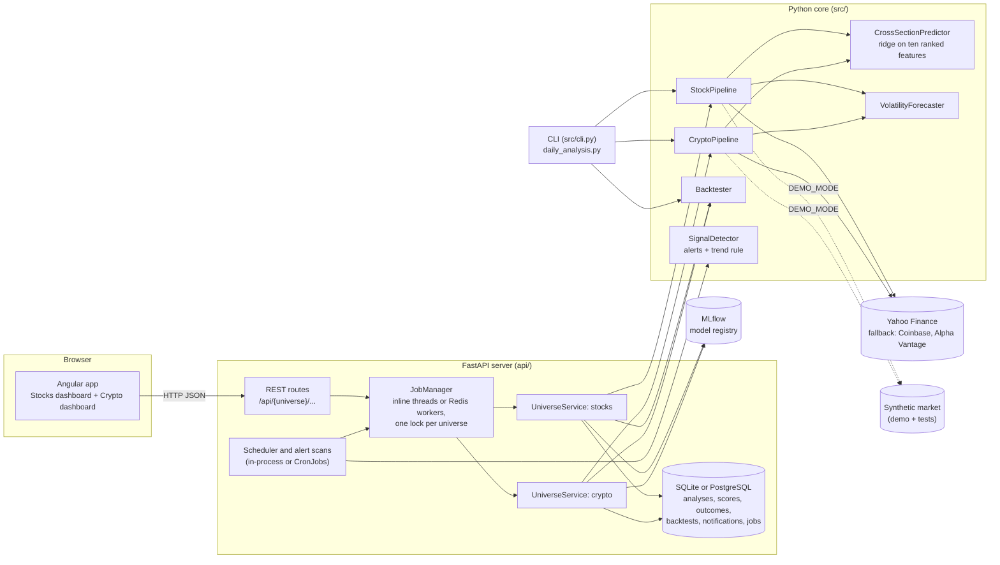

# Architecture

Ledger ranks US stocks and crypto by how likely each is to beat the rest of its
universe over the next few days, and shows at every step how much evidence
there is that the ranking works. This page is the map: the system, the modules,
the rules the results depend on and the key decisions. The detail is in
[`docs/design/`](design/) and the reasons are in [`docs/adr/`](adr/).

- [Purpose and scope](#purpose-and-scope)
- [System overview](#system-overview)
- [Module map](#module-map)
- [Where the detail lives](#where-the-detail-lives)
- [Rules the results depend on](#rules-the-results-depend-on)
- [Checks in CI](#checks-in-ci)
- [Key decisions](#key-decisions)

## Purpose and scope

**Goal.** For each universe, rank its assets by the probability of beating the
universe's average return over the next *h* days (default 5), build a
risk-aware portfolio from the top of the ranking, and make the evidence for or
against the model's skill impossible to miss.

**Principles.**

- *Measure what matters.* The headline metric is the out-of-sample rank
  information coefficient (IC), not accuracy. For short-horizon returns an IC of
  0.03–0.05 is good; next-day direction accuracy above 60% almost always means a
  bug.
- *Never peek.* Every feature, every training set and every backtest decision
  uses only data available at that moment. Tests enforce this.
- *Separate what is different.* Stocks and crypto have separate pipelines,
  models, settings, dashboards and records.
- *Predict what is predictable.* Volatility is far more forecastable than
  direction, so it gets its own model and page.

**Not in scope.** Placing trades, managing real money, or giving financial advice.
What real data showed about the predictor is in
[`docs/research/`](research/2026-11-predictor-review.md).

## System overview

The **Python core** (`src/`) holds all prediction logic and works on its own
through the CLI. The **API** (`api/`) wraps it with background jobs,
persistence and JSON endpoints. The **frontend** (`frontend/`) is an Angular
single-page app that only talks to the API; in production the API also serves
the built frontend, so one process and one port run the whole app. The
sequence of one analysis is in [analysis §5](design/analysis.md#5-analysis-flow).

## Module map

| Path | Responsibility | Key types |
|---|---|---|
| `src/data/collector.py` | Yahoo Finance access: prices, company info, indices; rate limiting, retries, caching; config loading | `DataCollector`, `load_config` |
| `src/data/providers.py` | Fallback price sources used when Yahoo fails | `CoinbaseProvider`, `AlphaVantageProvider` |
| `src/data/synthetic.py` | Deterministic synthetic markets with GARCH volatility and an optional planted signal (`reversal`, `alpha`) | `generate_market`, `SyntheticDataCollector` |
| `src/data/preprocessor.py` | Cleaning; return, volatility, moving-average, momentum, candlestick and support/resistance features; targets | `DataPreprocessor`, `add_relative_targets` |
| `src/analysis/technical_indicators.py` | RSI (Wilder), MACD, Bollinger, Stochastic, CCI, MFI, ATR, OBV, ADX, chart patterns | `TechnicalAnalyzer` |
| `src/models/cross_section.py` | **The return model**: residual returns, ten ranked `XS_*` features, `Target_XS`, ridge (optional XGBoost), calibration | `CrossSectionPredictor`, `add_cross_section_features` |
| `src/models/ml_models.py` | Purged split, IC, reliability table; the `legacy` classifier ensemble | `ReturnPredictor`, `information_coefficient` |
| `src/models/volatility.py` | Forward-volatility classifier and regressor with a naive baseline | `VolatilityForecaster` |
| `src/models/forecast.py` | Price ranges (split-conformal) for the Forecast page, and how often past ranges held | `RangeForecaster` |
| `src/models/registry.py` | Model registry on MLflow: training runs, versions, champion and pinning | `ModelRegistry` |
| `src/prediction/asset_ranker.py` | Shared pipeline: settings, `rank_assets`, `analyse`; assembles the three steps below | `AssetRanker` |
| `src/prediction/features.py` | Step 1: indicators, features and targets per asset and for the universe | `FeaturesMixin` |
| `src/prediction/training.py` | Step 2: the next-week and long-term models, export and import | `TrainingMixin` |
| `src/prediction/scoring.py` | Step 3: component scores, the composite, percentiles | `ScoringMixin`, `composite_score` |
| `src/prediction/pipelines.py` | Universe overrides and the factory | `StockPipeline`, `CryptoPipeline`, `create_pipeline` |
| `src/prediction/portfolio.py` | Sector cap and inverse-volatility weights | `select_portfolio` |
| `src/backtest/backtester.py` | Walk-forward, purged backtest with IC, attribution and market sensitivity | `Backtester`, `BacktestResult` |
| `src/signals/detector.py` | Market signals: unusual moves, volume spikes, gaps, market-wide moves, changed picks, rising volatility; protection alerts | `SignalDetector`, `Signal`, `detect_from_analysis` |
| `src/signals/trend.py` | The trend rule, its record on a universe's own history, the accuracy bar | `trend_state`, `rule_record`, `trend_verdict` |
| `src/evaluation/comparator.py` | Predicted vs actual: deciles, calibration, IC over time, breakdowns | `build_report` |
| `src/evaluation/experiments.py` | Setting experiments on a shared development period and a locked recent period | `ExperimentRunner`, `validate_settings`, `ALLOWED_SETTINGS` |
| `src/personal/portfolio.py` | Your portfolio: holdings from transactions, history against a cash-flow-matched benchmark, risk warnings | `apply_transactions`, `value_history`, `risk_warnings` |
| `src/personal/brief.py` | The weekly brief: rule-based plain sentences and what to do | `market_section`, `actions`, `to_markdown` |
| `src/cli.py`, `src/cli_output.py` | The command line (commands in `cli.py`, what they print in `cli_output.py`) | |
| `api/main.py` | FastAPI app, routes and static frontend; only wires routes | `create_app` |
| `api/service/` | Per-universe orchestration, one module per domain: `core.py` (state, analysis, asset and market pages, scans, trend view), `track_record.py`, `forecasts.py`, `portfolio.py` (with the brief), `performance.py` (backtests, experiments), `models.py` (registry) | `UniverseService` and its mixins |
| `api/db.py`, `api/migrations/` | Tables (`TABLES`), engine for SQLite or PostgreSQL, Alembic migrations | `migrate` |
| `api/store.py` | All queries | `Store`, `NotificationStore` |
| `api/jobs.py`, `api/tasks.py`, `api/worker.py` | Jobs in the database, run inline or by Redis workers, per-universe locks | `JobManager`, `Runner` |
| `api/notifications.py` | Publishing, channel interface, scan schedule | `Notifier`, `NotificationChannel`, `scan_times` |
| `api/settings.py`, `security.py`, `metrics.py`, `logging_setup.py`, `serialization.py` | Environment settings, headers and CSP, Prometheus metrics, logging, JSON conversion | `Settings` |
| `frontend/src/app/` | Angular 22: `pages/` (one per menu entry), `shared/` (chart, hint, evidence meter, score bar), `core/` (API client, stores, types, `format.ts`, `glossary.ts`) | see [api-frontend §13](design/api-frontend.md#13-frontend) |
| `config/config.yaml` | Universes, model, ranking weights, backtest, experiments, signals, scheduler | |
| `scripts/` | `daily_analysis.py` (one analysis without a server), `backup.py`, `k8s_trigger.py`, `check.sh`, `check_code.py`, `check_terms.py`, `lib/common.sh` | |
| `deploy/helm/ledger`, `deploy/gitops` | Helm chart with Prometheus alert rules, Flux manifests | |
| `run.sh`, `kube.sh`, `Dockerfile`, `docker-compose.yml` | Run paths: local, Docker, k3d | |
| `tests/` | Offline pytest suite; `tests/prometheus/` holds promtool tests for the alert rules | |

## Where the detail lives

Section numbers (§) are stable; each section sits in one file.

| § | Topic | File |
|---|---|---|
| 4–9 | Two pipelines, analysis flow, features and targets, scoring and portfolio, return model, volatility model | [design/analysis.md](design/analysis.md) |
| 10, 11, 11b | Backtest, track record, predicted vs actual and experiments | [design/evaluation.md](design/evaluation.md) |
| 11a | Market signals, alerts and the trend rule | [design/alerts.md](design/alerts.md) |
| 11c, 11d, 11e, 14 | Model registry, monitoring, database and jobs, data sources, demo mode, deployment | [design/operations.md](design/operations.md) |
| 11f, 11g, 11h | Price ranges, your portfolio, the weekly brief | [design/personal.md](design/personal.md) |
| 12, 13 | API and frontend | [design/api-frontend.md](design/api-frontend.md) |
| 15, 16, 18, 19 | Configuration reference, testing strategy, known limitations, extension points | [design/reference.md](design/reference.md) |
| 17 | Design decisions | [docs/adr/](adr/) (below) |

## Rules the results depend on

Breaking one silently makes every number in the app wrong. Reviews check these
first (the same list is in `AGENTS.md`).

1. **No future information.** A feature at date *t* uses data up to *t*. Targets
   (`Future_*`, `Target_*`) are excluded from features by name
   (`NON_FEATURE_COLUMNS`, the `XS_` prefix check). Training rows need labels
   known at decision time (purge gap = horizon).
2. **Stocks and crypto stay separate:** pipeline instances, models, settings,
   stored analyses and registry entries.
3. **Evaluate honestly:** chronological purged splits, rank IC with
   t-statistics, after-cost backtests. Do not tune on the lockbox period.
4. **Rank on the model's raw score, never the calibrated probability.**
5. **Tests stay offline:** use `SyntheticDataCollector` (`reversal=0.2` plants a
   known signal, `0.0` has none). Live-data tests are marked `network`.
6. **A model change needs both directions tested:** it finds the planted signal
   and finds nothing on a market without one.
7. **Count independent periods.** Outcomes over *h* days overlap, so
   t-statistics on daily ICs use `information_coefficient(…, overlap=h)`.

## Checks in CI

| Workflow | Jobs | What they guard |
|---|---|---|
| Tests (`tests.yml`) | `backend` (Python 3.10, 3.12, 3.13), `backend-postgres`, `frontend` (Vitest and production build), `presentation` (deck build) | The offline suite on SQLite and PostgreSQL, the web app, the deck |
| | `snapshots` | Analysis output equals the base branch's ([ADR 3](adr/0003-compare-snapshots-with-base-branch.md)); skipped with the `changes-output` label |
| | `code` | `scripts/check_code.py` (no `.py` or `.ts` file over 500 lines, no unused code) and `scripts/check_terms.py` (retired glossary names) |
| Kubernetes (`kubernetes.yml`) | `chart`, `deploy`, `gitops`, `scaled` | helm lint, kubeconform, promtool, then a full k3d deploy with monitoring, GitOps, scaled mode and backup, lose the volume, restore |
| Release (`release.yml`) | `image`, `gitops`, `chart` | Image build, Grype scan, and recording the tag for Flux |
| Security (`security.yml`) | `secrets`, `dependencies`, `workflows` | gitleaks, pip-audit and npm audit, zizmor |
| Scorecard, Daily analysis | `analysis`, `predict` | Repository posture (on `main`, weekly); the daily analysis artifact |

Locally, `scripts/check.sh --quick` runs the fast Python tests plus the
frontend tests and build, and `scripts/check.sh` runs everything CI runs that
works without a cluster.

## Key decisions

Each entry has a short ADR with the context, the decision and what follows.

- [ADR 1](adr/0001-remove-sentiment.md): remove the news sentiment score.
- [ADR 2](adr/0002-model-alone-default-composite.md): the model alone is the default composite.
- [ADR 3](adr/0003-compare-snapshots-with-base-branch.md): compare analysis snapshots with the base branch, never commit them.
- [ADR 4](adr/0004-trend-rule-only-as-protection.md): the trend rule is offered only as protection, behind an accuracy bar.
- [ADR 5](adr/0005-no-stock-alerts.md): no buy or sell alerts on stocks ([research](research/2026-11-predictor-review.md)).
- [ADR 6](adr/0006-relative-target-over-five-days.md): predict the return relative to the universe over 5 days.
- [ADR 7](adr/0007-rank-ic-as-headline-metric.md): rank IC, not accuracy, is the headline metric.
- [ADR 8](adr/0008-purged-split-and-walk-forward.md): purged chronological split and walk-forward retraining.
- [ADR 9](adr/0009-probability-shown-score-ranks.md): show calibrated probabilities, rank on the raw score.
- [ADR 10](adr/0010-separate-pipelines-per-universe.md): separate pipelines for stocks and crypto.
- [ADR 11](adr/0011-inverse-volatility-weights-with-sector-cap.md): inverse-volatility weights with a sector cap.
- [ADR 12](adr/0012-background-jobs-with-polling.md): analyses run as background jobs that the UI polls.
- [ADR 13](adr/0013-sqlite-by-default-postgresql-when-deployed.md): SQLite by default, PostgreSQL when deployed.
- [ADR 14](adr/0014-angular-signals-without-ui-kit.md): Angular with signals and no UI kit.
- [ADR 15](adr/0015-self-hosted-font.md): the font is self-hosted.

Known limitations (survivorship bias, free data, execution costs, an unofficial
Yahoo client, synthetic demo numbers) are in
[reference §18](design/reference.md#18-known-limitations).
