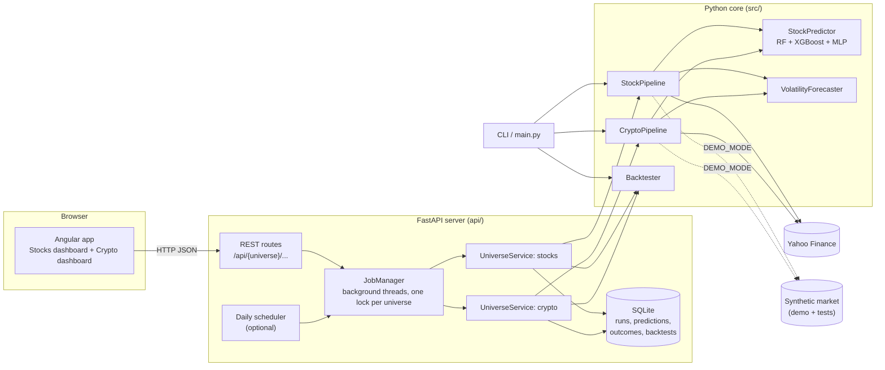
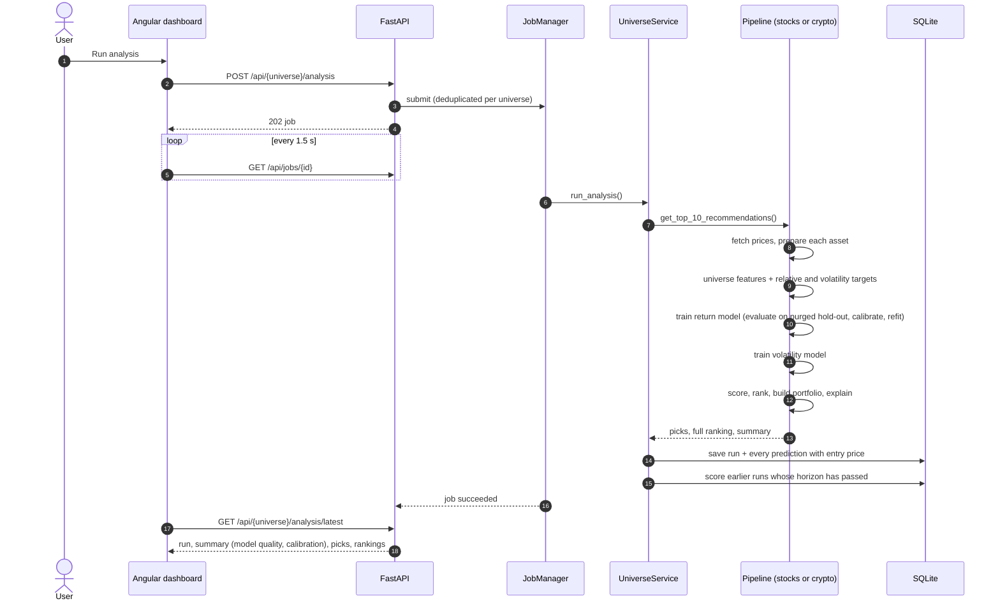
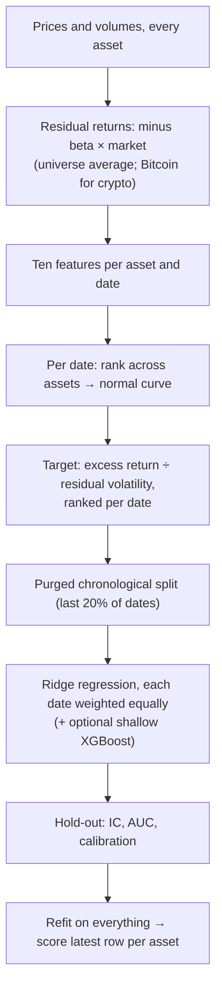
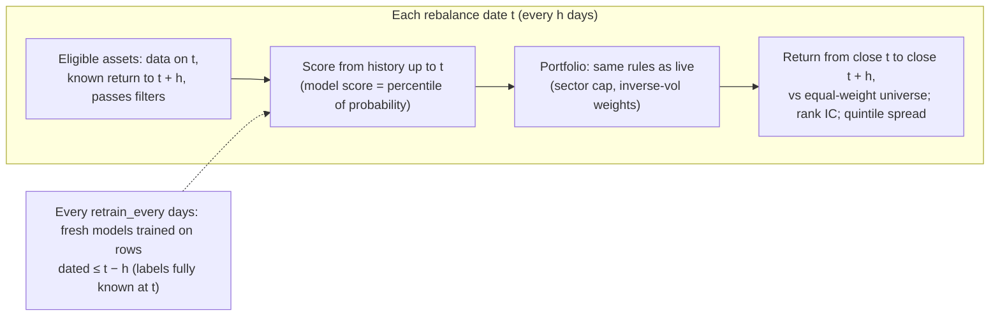
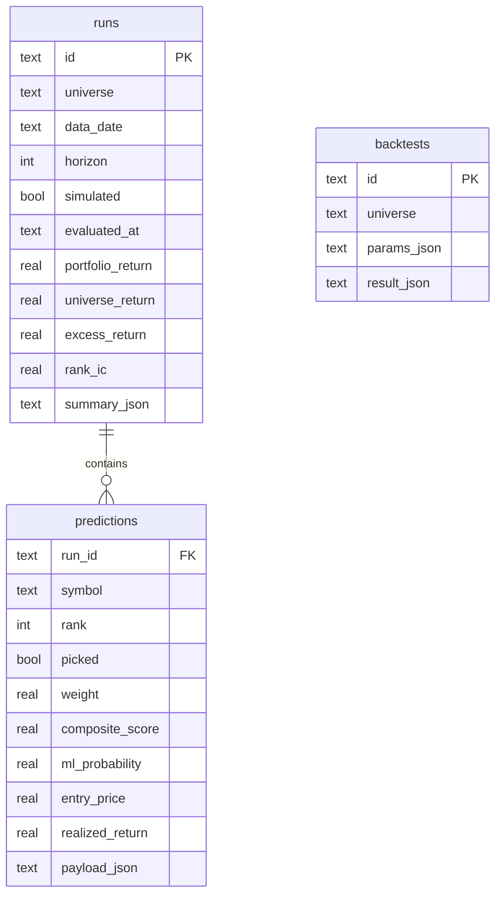
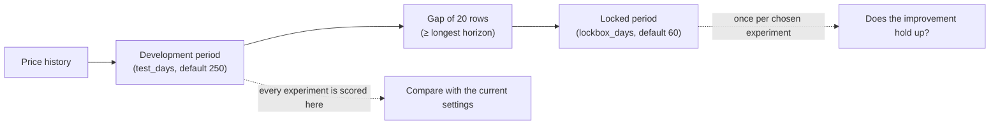
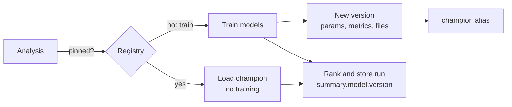
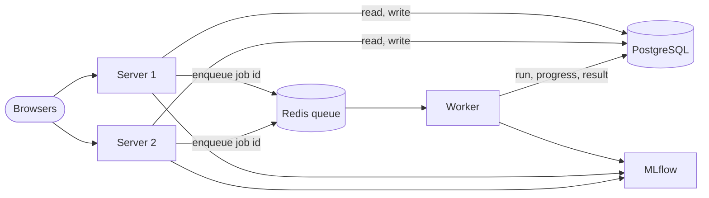

# Architecture

Ledger ranks US stocks and crypto by how likely each is to beat the rest of its
market over the next few days, and shows, at every step, how much evidence there
is that the ranking works. This document describes how it is built.

- [1. Purpose and scope](#1-purpose-and-scope)
- [2. System overview](#2-system-overview)
- [3. Module map](#3-module-map)
- [4. Two pipelines: stocks and crypto](#4-two-pipelines-stocks-and-crypto)
- [5. Analysis flow](#5-analysis-flow)
- [6. Feature pipeline and targets](#6-feature-pipeline-and-targets)
- [7. Scoring and portfolio construction](#7-scoring-and-portfolio-construction)
- [8. Return model](#8-return-model)
- [9. Volatility model](#9-volatility-model)
- [10. Backtest design](#10-backtest-design)
- [11. Track record](#11-track-record)
- [11a. Market signals and alerts](#11a-market-signals-and-alerts)
- [11b. Predicted vs actual and experiments](#11b-predicted-vs-actual-and-experiments)
- [11c. Model registry](#11c-model-registry)
- [11d. Monitoring](#11d-monitoring)
- [11e. Database, jobs and scaling out](#11e-database-jobs-and-scaling-out)
- [11f. Price ranges (Forecast)](#11f-price-ranges-forecast)
- [12. API](#12-api)
- [13. Frontend](#13-frontend)
- [14. Data sources, demo mode and deployment](#14-data-sources-demo-mode-and-deployment)
- [15. Configuration reference](#15-configuration-reference)
- [16. Testing strategy](#16-testing-strategy)
- [17. Design decisions](#17-design-decisions)
- [18. Known limitations](#18-known-limitations)
- [19. Extension points](#19-extension-points)

---

## 1. Purpose and scope

**Goal.** For each asset class, rank the universe by the probability of beating
the universe's average return over the next *h* days (default 5), build a
risk-aware portfolio from the top of the ranking, and make the evidence for or
against the model's skill impossible to miss.

**Principles.**

- *Measure what matters.* The headline metric is the out-of-sample rank
  information coefficient (IC), not accuracy. For short-horizon returns an IC of
  0.03–0.05 is good; next-day direction accuracy above 60% almost always means a
  bug.
- *Never peek.* Every feature, every training set and every backtest decision
  uses only data available at that moment. This is enforced by tests.
- *Separate what is different.* Stocks and crypto have separate pipelines,
  models, settings, dashboards and records.
- *Predict what is predictable.* Volatility is far more forecastable than
  direction, so it gets its own model and page.

**Not in scope.** Placing trades, managing real money, or giving financial advice.

---

## 2. System overview



The **Python core** (`src/`) contains all prediction logic and works on its own
through the CLI. The **API** (`api/`) wraps it with background jobs, persistence
and JSON endpoints. The **frontend** (`frontend/`) is an Angular single-page app
that only talks to the API. In production the API also serves the built
frontend, so one process and one port run the whole app.

---

## 3. Module map

| Path | Responsibility | Key types |
|---|---|---|
| `src/data/collector.py` | Yahoo Finance access: prices, company info, news, indices; rate limiting, retries, caching; config loading | `DataCollector`, `load_config` |
| `src/data/synthetic.py` | Deterministic synthetic markets (stocks or 7-day crypto) with GARCH volatility and an optional planted signal | `generate_market`, `SyntheticDataCollector` |
| `src/data/preprocessor.py` | Cleaning; return, volatility, moving-average, momentum, candlestick and support/resistance features; absolute, relative and volatility targets | `DataPreprocessor`, `add_relative_targets` |
| `src/analysis/technical_indicators.py` | RSI (Wilder), MACD, Bollinger, Stochastic, CCI, MFI, ATR, OBV, ADX, chart patterns, signal flags | `TechnicalAnalyzer` |
| `src/analysis/sentiment_analysis.py` | News polarity, VIX fear/greed, sector ETFs (stocks only) | `SentimentAnalyzer` |
| `src/models/cross_section.py` | The return model: residual returns, ten ranked features, ridge regression, calibration | `CrossSectionPredictor`, `add_cross_section_features` |
| `src/models/ml_models.py` | Purged chronological split, IC, reliability table; the legacy classifier ensemble | `StockPredictor`, `information_coefficient` |
| `src/models/volatility.py` | Forward-volatility classifier and regressor with naive baseline | `VolatilityForecaster` |
| `src/models/forecast.py` | Price ranges for the next day and week, calibrated on past moves, and their reliability | `RangeForecaster` |
| `src/models/registry.py` | Model registry on MLflow: record training runs, version models, champion and pinning | `ModelRegistry` |
| `src/prediction/stock_ranker.py` | Shared pipeline: prepare → train → score → rank → portfolio | `StockRanker`, `composite_score` |
| `src/prediction/pipelines.py` | Asset-class pipelines and factory | `StockPipeline`, `CryptoPipeline`, `create_pipeline` |
| `src/prediction/portfolio.py` | Sector cap and inverse-volatility weights | `select_portfolio` |
| `src/backtest/backtester.py` | Walk-forward, purged, horizon-aware backtest with IC and attribution; logs every prediction | `Backtester`, `BacktestResult` |
| `src/signals/detector.py` | Unusual moves, volume spikes, gaps, market-wide moves; portfolio and volatility alerts | `SignalDetector`, `detect_from_analysis` |
| `src/evaluation/comparator.py` | Predicted vs actual: deciles, calibration, IC over time, breakdowns | `build_report` |
| `src/evaluation/experiments.py` | Setting experiments on a shared development period, locked recent period | `ExperimentRunner`, `validate_settings` |
| `src/cli.py`, `main.py` | Command-line entry points (`--universe stocks|crypto`) | |
| `api/main.py` | FastAPI app, routes, scheduler, static frontend | `create_app` |
| `api/service.py` | Per-universe orchestration: analysis, outcomes, backtests, page data | `UniverseService` |
| `api/db.py`, `api/migrations/` | Schema (SQLite or PostgreSQL), engine, Alembic migrations | `migrate` |
| `api/store.py` | Queries | `Store` |
| `api/jobs.py`, `api/tasks.py`, `api/worker.py` | Jobs in the database, run inline or by Redis workers, with per-universe locks | `JobManager`, `Runner` |
| `api/notifications.py` | Notification publishing, channel interface, twice-daily scan schedule | `Notifier`, `scan_times` |
| `frontend/src/app/` | Angular app: shell, per-dashboard layout, pages, shared components | see §13 |

---

## 4. Two pipelines: stocks and crypto

`StockRanker` holds everything shared. `StockPipeline` and `CryptoPipeline`
subclass it, and `create_pipeline(universe)` returns the right one. Each
instance owns its own `StockPredictor` and `VolatilityForecaster`, saves its
models to its own file (`data/models/{universe}.joblib`), and writes its own
runs to the database, so nothing learned on one asset class affects the other.

| | Stocks | Crypto |
|---|---|---|
| Universe | ~100 liquid S&P 500 names | 22 major coins (`BTC-USD`, …) |
| Calendar | trading days, 252 per year | every day, 365 per year |
| Extra features | return vs. the average stock (5d, 20d), 20-day return rank | return vs. Bitcoin (5d, 20d), 30-day beta and correlation to Bitcoin, Bitcoin's own 5-day return |
| Grouping | sector (Yahoo Finance) | category (store of value, smart-contract platform, payments, DeFi, …) |
| Portfolio | max 3 per sector, inverse-volatility weights | no category cap, inverse-volatility weights |
| Filters | price ≥ $5, ≥ 1M shares/day, cap ≥ $1B | ≥ $10M/day volume, cap ≥ $1B; any price |
| Sentiment | news, VIX, sector ETFs | off (VIX and sector ETFs do not apply) |
| Market header | S&P 500, Nasdaq, Dow, VIX, gold, bonds | BTC, ETH, SOL |
| Suggested cost | 5 bp per trade | 10–20 bp per trade |

Both share the indicator set, the scoring rules, the model architecture and the
backtest engine, which keeps results comparable and the code small.

---

## 5. Analysis flow



Jobs run on a two-thread pool with one lock per universe: a stock job and a
crypto job run in parallel; two jobs on the same universe queue. Starting an
analysis that is already running returns the existing job.

---

## 6. Feature pipeline and targets

`prepare_symbol_data` runs per asset; `prepare_universe` then adds features and
targets that need the whole universe.

| Stage | Adds |
|---|---|
| Clean | drop duplicate dates, forward-fill gaps (never back-fill), repair >50% one-day spikes, fix non-positive volume |
| Basic features | returns, 5/20/60-day volatility, short/long volatility ratio, absolute return, range, volume ratio, gaps |
| Moving averages | SMA/EMA 5–200, price vs. average, distance from average, crosses |
| Momentum | rate of change 1/5/10/20 days, Williams %R, CCI |
| Candles | body and shadows, doji, hammer, engulfing, streaks |
| Support/resistance | 20-day range, distances, breakouts |
| Indicators | RSI, MACD, Bollinger, Stochastic, MFI, ATR, OBV, ADX, `*_Pct` scale-free versions, chart patterns (latest row only) |
| Targets | `Future_Return` over *h* days, `Target_Up`; `Future_Vol` and `Target_Vol_Up` over 5 days |
| Universe | `Future_Excess` and `Target_Up_Rel` (return minus the equal-weight universe average), market volatility and return, asset-class features (§4) |
| Cross-section | the return model's ten ranked `XS_*` features and its `Target_XS` target (§8) |

**Why a relative target.** On any given day most stocks move with the market,
and no stock-level feature predicts the market. Subtracting the universe average
removes that unpredictable common move and leaves exactly what a ranking can
exploit. It also makes the classes balanced (about half beat the average).

**Causality.** Every feature at date *t* uses data up to *t*. Targets look
forward and are excluded from features by name; the "scramble the future" test
(§16) enforces this end to end.

---

## 7. Scoring and portfolio construction

Each asset gets component scores on 0–100:

| Component | Default weight | How |
|---|---|---|
| Model | 1.0 | cross-sectional percentile of the return model's score (best asset = 100) |
| Technical | 0 | rules on RSI, MACD, Bollinger position, moving averages, volume, chart patterns |
| Momentum | 0 | weighted rate of change, volatility and up-day streaks |
| Volume | 0 | volume vs. average, volume trend, price–volume agreement, OBV trend |
| Sentiment | 0 | stocks only, live only |

**Why the model alone.** The hand-made scores were the original design, with
fixed weights 0.25 / 0.35 / 0.20 / 0.10 / 0.10. Measured on the demo market,
whose only signal is a planted short-term reversal, the momentum score pointed
the wrong way (its largest input rewards yesterday's rise; IC −0.075), the
technical score mixed reversal rules (RSI, Bollinger) with trend rules (MACD,
moving averages), and the fixed weights averaged a positive and a negative
signal into an IC of 0.009. The return model (§8) now sees the ideas behind
those scores as features and learns from history which way each points and how
much it is worth. The component scores are still computed and shown as
plain-language explanations, and experiments can give them weight again.

The model score is a percentile rather than a probability because
probabilities for relative returns cluster near 50%; ranking spreads the score
across 0–100. Ranking uses the model's raw score, never the calibrated
probability, so calibration cannot reorder assets.

The **composite** is a weighted average over the components that exist,
renormalised so a missing component (sentiment for crypto, or in a backtest)
does not drag scores down.

**Portfolio** (`select_portfolio`): take assets in composite order, skipping any
that would exceed the per-sector cap, until *N* are chosen; then weight them in
proportion to 1 / volatility so each contributes similar risk.

**Explanations.** For each asset the API returns the plain-language signals
(e.g. "RSI 27: oversold") and the model's contribution per feature (ridge
weight × the asset's ranked value), so the dashboard can show what pushed a
score up or down.

---

## 8. Return model

`src/models/cross_section.py`, selected by `ml_config.model: cross_section`
(the default). `legacy` keeps the earlier classifier ensemble, described at
the end of this section.



**Residual returns.** Each asset's daily log return minus its 120-day beta times
the market's return. The market's move is shared by every asset, so no asset's
history can rank it; what is left is the part a ranking can use.

**Features.** Each one is a known effect with a reason to exist, not one of
dozens of overlapping indicators:

| Feature | Formula (data up to *t*) | Why |
|---|---|---|
| `rev_1d` | −residual return today ÷ σ₆₀ | short-term overreaction reverses |
| `rev_5d` | −5-day residual return ÷ (σ₆₀ √5) | weekly reversal |
| `mom_12_1` (stocks) | log(P[t−21] ÷ P[t−252]) | 12-month momentum, skipping the last month |
| `mom_30`, `mom_90` (crypto) | log(P[t] ÷ P[t−30]), log(P[t] ÷ P[t−90]) | crypto trends over weeks |
| `low_vol` | −60-day volatility | low-volatility anomaly |
| `low_beta` | −120-day beta | betting against beta |
| `z_ma20` | −(P ÷ 20-day mean − 1) ÷ (σ₂₀ √20) | stretched prices pull back |
| `high52` | P ÷ 1-year high | anchoring to the 52-week high |
| `max_ret` | −largest daily return over 21 days | lottery-like assets disappoint |
| `vol_shock` | log(volume ÷ 20-day mean) | attention and news |
| `rev_x_vol` | `rev_1d` × −`vol_shock` | quiet moves reverse more than loud ones |

σ₆₀ is the 60-day volatility of residual returns.

**Per-date ranks.** On each date every feature becomes its rank among the
assets, mapped onto a standard normal curve (clipped at 1% and 99%); missing
values are 0, the average. The model therefore compares assets with each other
rather than with the past, is unaffected by calm versus turbulent periods, and
is not pulled around by outliers. Features are stored on the prepared frames
as `XS_*` columns, so a single row can be scored on its own.

**Target.** Return over *h* days minus the universe average, divided by
σ₆₀ √h, ranked per date onto the normal curve (`Target_XS`). It is a regression
on the size of the outperformance, so a large win teaches more than a coin flip
around zero, and volatile assets do not dominate.

**Model.** Ridge regression with strong shrinkage (α = 1000), each date weighted
equally. Its ten signed weights are readable: they say which effects history
rewarded. An optional XGBoost regressor (depth 2, 300 trees, learning rate
0.03, at least 200 samples per leaf) can run beside it as a challenger; their
scores are averaged when enabled.

**Evaluation and calibration.** The last 20% of dates, after a purge gap of *h*
dates, are held out. The IC is the Spearman correlation between the score and
the realised excess return across assets on each hold-out date. A logistic
calibrator fitted on the hold-out turns the score into the probability of
beating the universe; it sits near 50–55%, which is honest for this problem.
The models used for today are then refit on every date.

**Measured on the demo market** (40 assets, 5 years, planted reversal of 20%):

| | Out-of-sample IC | Backtest, excess per 5 days after costs |
|---|---|---|
| Earlier composite (hand-made scores + legacy ensemble) | 0.009 | ≈ 0 |
| Cross-sectional model | 0.076 (t 3.5) | +39 bp (t 3.2) |
| Same model, market with no signal | ≈ 0 | — |

On real markets the effects are far weaker; an IC of 0.02–0.04 would be good.

**Legacy model** (`ml_config.model: legacy`): Random Forest, XGBoost and an MLP
classifying "beats the universe" on ~86 pooled, scale-free indicators, with
`TimeSeriesSplit(gap=h)` cross-validation, Platt calibration and SHAP
explanations. On the demo market it overfit (62–65% training accuracy, 50% on
the hold-out) and did not find the planted signal; it is kept for comparison
in experiments.

---

## 9. Volatility model

Volatility clusters: big moves follow big moves. `VolatilityForecaster` pools the
universe and fits two gradient-boosted models on volatility features (5/20/60-day
volatility and their ratio, range, ATR, Bollinger width, recent returns, market
volatility):

- a **classifier** for "will the next 5 days' realised volatility exceed the
  trailing 20-day level?", reported as accuracy against the majority-class rate
  and AUC;
- a **regressor** for log future volatility, reported as R² against the naive
  forecast "volatility stays at its 20-day level".

Both are evaluated on a purged chronological hold-out, then refit. On real data
this kind of model typically reaches 65–75% accuracy, which is honest skill
rather than an artefact. On the synthetic demo market it reaches about 60%.

---

## 10. Backtest design



- **Holding periods** are non-overlapping blocks of *h* days, annualised with
  `periods_per_year / h` (252 for stocks, 365 for crypto).
- **Costs** are charged on actual weight changes: Σ|w_new − w_old| × cost.
- **Attribution.** Alongside the composite, the top *N* by each component alone
  (technical, momentum, volume, model), to show which parts carry signal.
- **Metrics.** Total and annualised return, volatility, Sharpe, maximum drawdown,
  average excess per period, excess t-statistic, share of periods beating the
  universe; and per score: mean rank IC, t-statistic, share positive, annualised
  information ratio.
- **Sentiment is excluded** (no point-in-time news archive).

---

## 11. Track record

Every API analysis stores the full ranking with entry prices before the outcome
exists. `evaluate_outcomes` runs after each analysis (and on demand): for every
run whose horizon has passed it computes each asset's realised return from its
own price history, then the portfolio's return, the universe average, the excess
and the rank IC. The Track record page summarises these with a t-statistic and a
cumulative chart.

In demo mode, a fresh database is seeded with a walk-forward backtest whose
periods are stored as **simulated** runs and always labelled as such; they never
appear as live predictions.



---

## 11a. Market signals and alerts

The detector does not predict; it notices what is unusual *for each asset*,
shortly after it happens, and raises an in-app alert.

| Alert | Rule (defaults) | Scan |
|---|---|---|
| Unusual move | today's return minus the universe average, ≥ 3 standard deviations of that difference over the last 60 bars (critical at 5) | open and close |
| Volume spike | volume ≥ 3× its 20-bar average without an unusual move (critical at 5×); folded into the move alert when both happen | close |
| Opening gap | open vs previous close ≥ 3 standard deviations and ≥ 2% (stocks) or 4% (crypto) | open and close |
| Market-wide move | the universe's average return ≥ 3 standard deviations of its own history, or ≥ 85% of assets down on a weak day | open and close |
| Portfolio change | a new analysis adds or drops picks | after each analysis |
| Volatility rising | a holding's volatility model says ≥ 70% chance of more volatility and forecasts ≥ 1.2× today's level | after each analysis |

Removing the universe average from each asset's move means a market-wide drop
produces one market alert, not one alert per asset.

**Schedule.** Two scans a day in New York time: 09:45 (after the open: gaps
and early moves) and 16:15 (after the close: everything). Stocks are scanned on
weekdays, crypto every day at the same times. Market holidays are not special-
cased: a holiday scan sees the previous day's bar, which deduplication ignores.

**Noise control.** An event is stored once per asset, type and day (dedupe
key), and an alert of the same type for the same asset is suppressed for 12
hours unless it is more severe. On realistic data about 1% of asset-days
trigger an alert, so a 100-stock scan typically raises one or two.

**Delivery.** Notifications are stored in SQLite and shown in the app (Alerts
page, unread badges). `Notifier` hands each new notification to any extra
channels; none are configured yet. Adding Telegram, email or Discord means
implementing `NotificationChannel.deliver` and passing it to `Notifier`.

---

## 11b. Predicted vs actual and experiments

**Prediction log.** Every backtest now records every scored asset on every
decision date (not only the picks): its scores, the model's probability,
whether it was picked, and its actual return and excess over the universe.
Live predictions produce the same log once their horizon has passed.

**Comparator** (`build_report`), shown on the *Predicted vs actual* page:

| View | What it answers |
|---|---|
| Deciles | Ranked within each date, do higher scores go with better results? A staircase means skill. |
| Components | Rank IC of the composite and of each part (model, technical, momentum, volume): which parts help and which point the wrong way |
| IC over time | Is skill steady, fading, or confined to some periods? (per-date IC and rolling average) |
| Calibration | Do stated probabilities come true at that rate? |
| Breakdowns | Skill by sector or coin category, by market mood (volatility terciles) and by market direction |
| Log | Every prediction next to its outcome; full CSV export |

**Experiments.** An experiment changes whitelisted settings (score weights,
horizon, target, model depth and size, which models run, position sizing,
sector cap, number of picks) and replays the walk-forward backtest. Settings
are validated against `ALLOWED_SETTINGS`; anything else is rejected.



- Windows are anchored to the price calendar, so every experiment, whatever
  its horizon, is judged on exactly the same dates.
- No development decision has an outcome inside the locked period (the gap is
  at least the longest allowed horizon).
- A locked-period check runs once per experiment and is then only read back,
  so it cannot be repeated until it looks good. The page shows how many
  experiments have used the locked period, because each look makes it a
  little less independent.

---

## 11c. Model registry

Every analysis that trains models records them in **MLflow**
(`src/models/registry.py`), so each prediction can be traced to the exact
model that made it.



- **One registered model per universe**: `ledger-stocks` and `ledger-crypto`,
  with `-demo` added for simulated data, so demo and real models never mix.
- **Each version** is an MLflow run with the settings as parameters (horizon,
  target, models, weights, number of assets and features, data date), the
  out-of-sample scores as metrics (`quality.ic_mean`, `quality.ic_t_stat`,
  `quality.test_auc`, Brier scores, volatility scores), the git commit as a
  tag, and the model files (`models.joblib`: return models, scalers,
  calibrator, volatility models and their test scores) as the `model` artifact.
- **Champion and pinning.** By default each analysis trains, registers a new
  version and moves the `champion` alias to it. Promoting a version (to roll
  back, for example) moves the alias and sets the registered model's `pinned`
  tag: analyses then load the champion and rank with it without training,
  until it is unpinned. An analysis that was training when a version got
  pinned registers its models without promoting them.
- **Traceability.** Each stored run's summary has `model: {version, reused,
  registry, run_id}`; the Outlook page shows it and links to the Models page.
- **Safety.** Loaded models check that every feature they need still exists
  (settings may have changed since they were trained) and that they belong to
  the same universe. A registry outage does not fail an analysis: the run is
  stored with `model.error` and the models are simply not registered.
- **Where it lives.** `MLFLOW_TRACKING_URI` selects the store. Without it, a
  SQLite file and an artifact folder next to the app's database are used
  (`data/mlflow-demo.db`, `data/mlartifacts-demo/`). On Kubernetes the chart
  runs an MLflow server with its own volume and web UI. `MODEL_REGISTRY=off`
  turns the registry off. Only the light `mlflow-skinny` client is installed
  in the app.

Backtests and experiments train many short-lived models to measure a setting;
those are not registered, since they are not used for live predictions.

## 11d. Monitoring

`GET /metrics` serves Prometheus metrics (`api/metrics.py`), each app on its
own registry:

- **Service**: requests and latency per route template (not per URL, so the
  number of series stays small), jobs by kind, universe and outcome, job
  durations, jobs running, the time each kind last succeeded, alerts published.
- **Data and models**, computed from the database when Prometheus scrapes, so
  they are right straight after a restart: price data age, the latest model's
  rank IC and t-statistic, the rank IC of the last 15 scored live analyses, and
  the registry's champion version and pinning.

On Kubernetes, `--monitoring` deploys Prometheus with alert rules (unit-tested
with `promtool`) and Grafana with a provisioned dashboard; see
[KUBERNETES.md](KUBERNETES.md#monitoring). `LOG_FORMAT=json` writes the
server's and uvicorn's logs as one JSON object per line, with job ids and
durations as fields.

---

## 11e. Database, jobs and scaling out

The app runs in one of two shapes, chosen by environment variables:

| | One process (default) | Scaled out |
|---|---|---|
| Database | SQLite file (`DATABASE_PATH`) | PostgreSQL (`DATABASE_URL`) |
| Jobs | Threads in the server (`JOB_QUEUE=inline`) | Redis queue and worker processes (`JOB_QUEUE=redis`, `python -m api.worker`) |
| Model registry | Local MLflow store next to the database | MLflow server (shared) |
| Server copies | 1 | any number |



- **Schema** (`api/db.py`): one SQLAlchemy Core definition for both databases,
  changed only through Alembic migrations (`api/migrations`). Each process
  migrates at startup; on PostgreSQL an advisory lock lets one process do it
  while the others wait. Databases created before migrations existed are
  adopted as they are.
- **Jobs are rows** (`jobs` table): kind, universe, JSON parameters, status,
  progress message, result, error, worker. The server inserts the row and, with
  Redis, enqueues only its id; any server copy can then report on it. A
  partial unique index on `(kind, universe)` for queued and running jobs keeps
  two copies of the same job from being queued, even by two servers at once.
- **Tasks by name** (`api/tasks.py`): `analysis`, `scan`, `seed`, `backtest`,
  `evaluate`, `experiment`, `lockbox`. The worker looks the name up and calls
  the universe's service, which is kept in memory between jobs (RQ's
  `SimpleWorker`, no fork per job).
- **Order per universe**: a thread lock inline, a Redis lock with workers, so
  jobs of one universe run one after the other while stocks and crypto run
  side by side.
- **Failure handling**: inline jobs interrupted by a restart are marked failed
  at the next start. With Redis, a job whose queue entry is gone or failed
  (worker killed, Redis restarted) is marked failed the next time it is looked
  at, so it never blocks new jobs. Redis holds nothing else, so it needs no
  persistence.
- **Moving between databases**: the backup script copies a database by URL table
  by table, and restores into either kind, so a SQLite backup can be loaded
  into PostgreSQL and the other way round (`./kube.sh up --postgres` does this).

---

## 11f. Price ranges (Forecast)

A single predicted price would mislead: over a day or a week the expected move
is tiny compared with the noise, so the honest point forecast is today's price.
The Forecast page shows **ranges** instead (`src/models/forecast.py`):

- **Volatility at each date**: an exponentially weighted volatility of daily
  log returns (decay 0.94), blended 70/30 with the one-year volatility, using
  only prices up to that date.
- **Standardized moves**: each past move over the horizon divided by
  `volatility × √days`. Their empirical quantiles, pooled over the universe and
  centred on zero, set the 5%, 25%, 75% and 95% levels. Fat tails are kept, and
  past drift is not treated as a forecast.
- **Horizons**: stocks get the next session and 5 sessions; crypto, which
  trades every day, gets 24 hours and 7 days.
- **Reliability** comes from three places:
  - When fitting, the quantiles come from earlier dates, and coverage is
    measured on the last quarter of dates after a purge gap.
  - Every live forecast is stored (`forecast_batches`, `forecasts`) and scored
    once its window has passed.
  - A new demo dashboard gets a replayed history, marked as simulated.

  The page, Track record, `/metrics` (`ledger_forecast_coverage`) and the
  `LedgerForecastRangesUnreliable` alert all use these scores.
- **When**: after every analysis, and on demand (`POST /api/{universe}/forecast`,
  the `forecast` job).

---

## 12. API

Interactive documentation is served at `/api/docs`. Every asset-class endpoint
takes `{universe}` = `stocks` or `crypto`.

| Method | Path | Purpose |
|---|---|---|
| GET | `/api/health` | status, version, demo flag |
| GET | `/api/universes` | both universes' settings |
| GET | `/api/{universe}` | one universe's settings and last run time |
| POST | `/api/{universe}/analysis` | start an analysis job (`top_n`, `symbols` optional) |
| GET | `/api/{universe}/analysis/latest` | latest live run: summary, model quality, calibration, picks, ranking |
| GET | `/api/{universe}/runs`, `/runs/{id}` | run history and detail with outcomes |
| GET | `/api/{universe}/assets/{symbol}` | 250 days of price and indicators, latest standing, reasons |
| GET | `/api/{universe}/volatility` | volatility model skill and per-asset forecasts |
| GET | `/api/{universe}/market` | benchmark moves for the header |
| GET | `/api/{universe}/track-record` | live and simulated summaries, curves, runs |
| POST | `/api/{universe}/track-record/evaluate` | score matured runs now |
| POST | `/api/{universe}/backtests` | start a backtest job (`top_n`, `test_days`, `retrain_every`, `cost_bps`, `use_ml`) |
| GET | `/api/{universe}/backtests`, `/backtests/{id}` | saved backtests and full results |
| GET | `/api/jobs`, `/api/jobs/{id}` | job status for polling |
| GET | `/api/notifications?universe=&unread_only=` | alerts, newest first |
| GET | `/api/notifications/unread` | unread counts per universe and severity |
| POST | `/api/notifications/{id}/read`, `/api/notifications/read-all?universe=` | mark as read |
| POST | `/api/{universe}/signals/scan` | scan now (`session`: `open` or `close`) |
| GET | `/api/signals/schedule` | scan times and the next runs |
| GET | `/api/{universe}/performance?source=&backtest_id=` | predicted-vs-actual report (live or a backtest) |
| GET | `/api/{universe}/performance/predictions.csv` | full prediction log as CSV |
| GET | `/api/experiments/settings` | settings an experiment may change, with ranges |
| GET/POST | `/api/{universe}/experiments` | list, or start an experiment (`name`, `settings`, `top_n`) |
| GET | `/api/{universe}/experiments/{id}` | one experiment with development and locked results |
| POST | `/api/{universe}/experiments/{id}/lockbox` | check on the locked period (once) |

Server settings come from environment variables (`api/settings.py`):
`CONFIG_PATH`, `DEMO_MODE`, `DATABASE_PATH`, `FRONTEND_DIST`, `CORS_ORIGINS`,
`SEED_DEMO`.

---

## 13. Frontend

Angular 22, standalone components, signals for state, lazy-loaded pages,
Chart.js for charts, no UI kit.

```
frontend/src/app/
├── app.ts / app.html            Shell: navigation rail with both dashboards, pages grouped by purpose
├── app.routes.ts                /stocks/... and /crypto/... share one set of page routes
├── core/
│   ├── api.service.ts           Typed HTTP client, job polling
│   ├── universe-store.ts        One signal store per dashboard (no shared state)
│   ├── models.ts                API response types
│   ├── format.ts                Number formatting, t-statistic → plain verdict
│   ├── glossary.ts              Every help definition, in one place
│   └── route-universe.ts        Which dashboard a route belongs to
├── shared/
│   ├── evidence-meter.ts        Out-of-sample IC on a scale with the luck band shaded
│   ├── chart.ts                 Chart.js wrapper, theme-aware colours, shared chart styling
│   ├── hint.ts                  Accessible "?" help tooltip
│   └── score-bar.ts
└── pages/
    ├── universe-layout.ts       Dashboard header, benchmarks, run button, accent colour
    ├── outlook.*                At-a-glance tiles, evidence, portfolio with reasons, full ranking, model facts, calibration
    ├── forecast.ts              Price ranges for the next day and week, and how often they held
    ├── models.ts                Model registry: versions, champion, pin and roll back
    ├── backtest.ts/html         Settings, verdict, equity curves, metrics, IC, recent picks
    ├── track-record.ts          Live vs simulated record
    ├── volatility.ts            Forecasts vs current volatility
    ├── alerts.ts                Alerts by day, severity, unread filter, check now
    ├── performance.*            Predicted vs actual: deciles, components, IC over time, calibration, breakdowns, log
    ├── experiments.*            Experiment form, comparison with the baseline, locked-period checks
    └── asset.ts                 Price with band, RSI, standing, reasons
```

**Two dashboards.** `/stocks` and `/crypto` render the same page components,
but each gets its own `UniverseStore`, its own API namespace and its own accent
colour (cobalt for stocks, violet for crypto), so they read as separate products
that share a design language.

**Design.** Graph-paper neutrals and slate ink; green and crimson are reserved
for outperformance and underperformance. Public Sans (self-hosted) with tabular
figures. The evidence meter leads each dashboard so the strength of the evidence
is the first thing a reader sees.

**Navigation** groups the pages by the question they answer: *Today* (Outlook,
Forecast, Volatility, Alerts), *Is it working?* (Track record, Backtest,
Predicted vs actual) and *Improve it* (Experiments, Models).

**Stat tiles.** Pages lead with a row of key figures (`.facts`): a label, the
number, and a short note. Longer explanations sit in collapsed "How it works"
sections, so a page can be read at a glance and studied when needed.

**Help hints.** Terms that need explaining (rank IC, t-statistic, Sharpe,
coverage, lockbox…) carry a small "?" button (`app-hint`) whose definition comes
from `core/glossary.ts`, so each term is explained the same way everywhere. It
follows WCAG 2.2 SC 1.4.13 and the usual tooltip guidance:
- it opens on hover after a short delay, on keyboard focus and on tap;
- it stays open while hovered;
- Escape, a click elsewhere or scrolling closes it;
- `aria-describedby` links it, it has a 24 px target, and only one is open at a time;
- it holds short definitions only, never information or actions a page needs.

Hints sit beside a label, not inside it, so they do not change form fields'
accessible names.

**Charts** share one style (`baseOptions`): 2 px lines with no dots until
hovered, bars at most 24 px wide with rounded ends, solid hairline gridlines,
and one tooltip listing every series at the hovered date. Light and dark themes follow the system
setting; keyboard focus is visible; motion is limited to a loading spinner and
respects reduced-motion settings.

In development `ng serve` proxies `/api` to `http://127.0.0.1:8000`
(`proxy.conf.json`). In production the FastAPI server serves the built files and
falls back to `index.html` for client-side routes.

---

## 14. Data sources, demo mode and deployment

**Yahoo Finance via `yfinance`** is the only required source: prices for stocks
and coins (`BTC-USD`), company info, news and index levels. The collector rate
limits (default 0.5 s between requests), retries with backoff, caches price
history for 15 minutes and company info per process, and normalises dates to a
timezone-free calendar.

**Demo mode** (`DEMO_MODE=true`, or `--demo` on the CLI) swaps in the synthetic
market: one-factor returns with GARCH volatility clustering and a mild planted
mean-reversion signal; crypto symbols get a 7-day calendar and higher volatility
around a Bitcoin-driven factor. It needs no network, is deterministic, and seeds
both dashboards on first start. Its numbers say nothing about real markets.

**Deployment.** The `Dockerfile` builds the Angular app in a Node stage and runs
it from the FastAPI server in a Python stage; `docker compose up --build` starts
it on port 8000 with a volume for the database and saved models. Any host that
runs a container works (Render, Railway, Fly.io, Hugging Face Spaces, a VM).
Hosted servers are often throttled by Yahoo Finance, so demo mode is the
reliable choice for a public demo.

**Kubernetes.** The Helm chart in `deploy/helm/ledger` runs the same image as a
single-replica Deployment with persistent volumes, an Ingress, health probes
(`/api/health`, `/api/ready`) and CronJobs for the alert scans and the daily
prediction, plus an MLflow server for the model registry. The scan jobs call the server's API (`scripts/k8s_trigger.py`)
rather than opening the database, and the server's own scheduler is turned off
(`INTERNAL_SCHEDULER=false`). `./kube.sh up` deploys it to a local k3d cluster.
Backups (`scripts/backup.py`, standard library only) copy each SQLite
database with SQLite's online backup and each folder file by file into one
archive with a checksummed manifest; a restore verifies everything before it
replaces anything. See [KUBERNETES.md](KUBERNETES.md).

---

## 15. Configuration reference

All settings are in `config/config.yaml`.

| Section | Key | Default | Effect |
|---|---|---|---|
| `universes.{stocks,crypto}` | `symbols` | see file | the universe |
| | `timeframe` | `2y` | history fetched |
| | `periods_per_year` | 252 / 365 | annualisation |
| | `use_sentiment` | true / false | news, VIX and sector sentiment |
| | `filters` | see §4 | price, volume, market cap |
| | `portfolio.max_per_sector` | 3 / 0 | sector cap (0 = none) |
| | `portfolio.weighting` | `inverse_volatility` | or `equal` |
| `technical_analysis.indicators` | `rsi`, `macd`, … | standard | indicator periods |
| `ml_config.models` | `random_forest`, `xgboost`, `neural_network`, `lstm` | see file | hyperparameters; `enabled: false` disables |
| `ml_config.training` | `target` | `relative` | or `absolute` |
| | `horizon` | 5 | days ahead |
| | `test_size` | 0.2 | hold-out share of dates |
| | `calibrate` | true | Platt calibration on the hold-out |
| | `cross_validate`, `cv_splits` | true, 3 | time-series CV with purge gap |
| `volatility` | `enabled`, `horizon` | true, 5 | volatility model |
| `ranking_config` | `weights`, `top_picks` | see §7, 10 | composite weights, portfolio size |
| `backtest` | `period`, `test_days`, `retrain_every`, `min_train_days`, `cost_bps` | 2y, 120, 20, 120, 5 | backtest defaults |
| `tracking` | `database` | `data/predictions.db` | SQLite file |
| `scheduler` | `enabled`, `time`, `universes` | false, 22:30, both | daily automatic analysis in the API |
| `signals` | `schedule.open`, `schedule.close`, `stocks_weekdays_only` | 09:45, 16:15 New York, true | alert scans |
| | `thresholds`, `cooldown_hours`, `history_days` | see §11a, 12, 60 | alert sensitivity |
| `experiments` | `test_days`, `lockbox_days` | 250, 60 | development and locked periods |
| `api_config` | `rate_limits`, `retry_attempts` | 7,200/h, 3 | Yahoo Finance behaviour |

---

## 16. Testing strategy

| Suite | Runs | Covers |
|---|---|---|
| `tests/` (pytest) | offline, ~2 min | data, indicators, models, both pipelines, portfolio, backtest, API |
| `frontend/` (Vitest + jsdom) | offline, seconds | formatting, evidence meter, every page for both dashboards (including Alerts, Predicted vs actual and Experiments), rendered from real API responses captured in demo mode |

Key checks:

- **No lookahead, twice over.** (1) Scrambling every price after a cutoff
  leaves every pick decided before the cutoff unchanged, with and without the
  model. (2) On data with no signal no strategy shows significant edge, while on
  data with a planted signal the model finds it (IC t > 3).
- **Methodology.** Purge gap size; relative targets sum to zero across the
  universe; calibration does not worsen the Brier score; SHAP contributions plus
  the bias equal the model's output; the volatility model beats the naive
  forecast on clustered data; RSI matches the published Wilder example.
- **Separation.** Stock and crypto pipelines have distinct models, model files,
  calendars and symbols; the crypto dashboard renders only crypto.
- **Alerts.** Planted crashes, volume spikes and gaps are caught; a quiet day
  raises nothing; a market-wide drop raises one alert; dedupe, cooldown and
  escalation; channel failures do not block others; schedule across weekends
  and the clock change.
- **Comparator and experiments.** Skilled scores make a staircase and unskilled
  ones show no edge; experiment windows are identical across horizons and never
  overlap the locked period; settings validation; a locked check runs once.
- **API.** Full job lifecycle, deduplication, outcome scoring against known
  prices, simulated runs never replacing live ones, validation errors.

CI (`.github/workflows/tests.yml`) runs the Python suite on 3.10, 3.12 and 3.13
and the frontend tests and production build on Node 22.

---

## 17. Design decisions

| Decision | Alternative | Why |
|---|---|---|
| Relative target over 5 days | absolute next-day direction | removes the unpredictable market move; signals persist longer than one day |
| IC as the headline metric | accuracy | measures ranking quality, which is what the product does; accuracy is misleading near 50% |
| Purged split and walk-forward retraining | random split | overlapping labels leak the future into training |
| Calibrated probabilities | raw model output | a displayed probability should mean what it says |
| Model score as a percentile | raw probability × 100 | relative-return probabilities cluster near 50% |
| Separate pipelines per asset class | one model for everything | different calendars, volatility and drivers; "beat the field" only makes sense within one market |
| Inverse-volatility weights, sector cap | equal weights | stops one volatile asset or one sector dominating the result |
| Jobs + polling | synchronous requests | training takes minutes; requests would time out |
| SQLite | a database server | single file, zero setup, enough for one user's history |
| Angular with signals, no UI kit | component library | the design is specific to this product and the bundle stays small (≈80 kB initial) |
| Self-hosted font | Google Fonts | works offline and in locked-down deployments, no third-party requests |

---

## 18. Known limitations

- **Survivorship bias.** Universes are today's large assets; backtests over past
  years exclude those that fell away, which flatters results.
- **Free data.** No fundamentals, estimates, options or order-book data; those
  are where most real edge comes from.
- **Execution.** Close-to-close fills with a fixed cost; no spread, impact or
  borrow costs.
- **Sentiment** is live-only and stocks-only.
- **`yfinance` is unofficial**; Yahoo may throttle or change it.
- **Demo numbers are synthetic** and say nothing about real markets.

---

## 19. Extension points

- **New asset class:** subclass `StockRanker` in `pipelines.py`, add
  `add_universe_features` and `asset_metadata`, register it in `PIPELINES`, and
  add a `universes` entry in the config. The API, backtest and frontend pick it
  up by key (add a navigation entry in `app.ts` and routes in `app.routes.ts`).
- **New data source:** implement the `DataCollector` methods used by the
  pipeline (see `SyntheticDataCollector`) and pass it to `create_pipeline`.
- **New feature:** compute it in the preprocessor, indicators or
  `add_universe_features`; if scale-free it becomes a model input automatically.
  Add a readable name to `FEATURE_LABELS` for explanations.
- **New model:** add a trainer and config block in `StockPredictor`; any
  classifier with `predict_proba` joins the ensemble and calibration.
