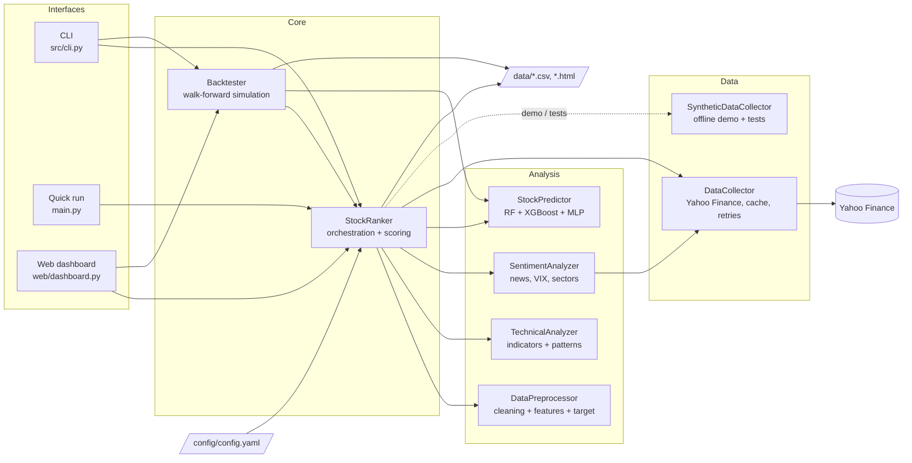
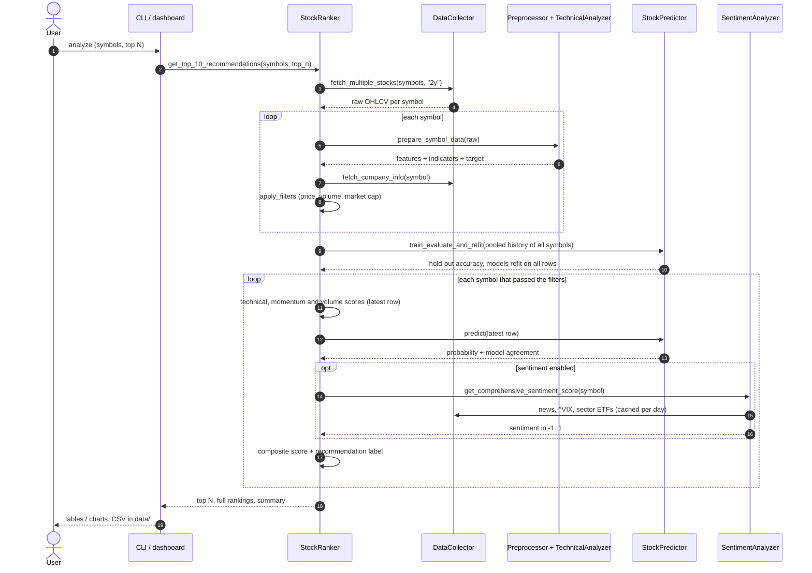
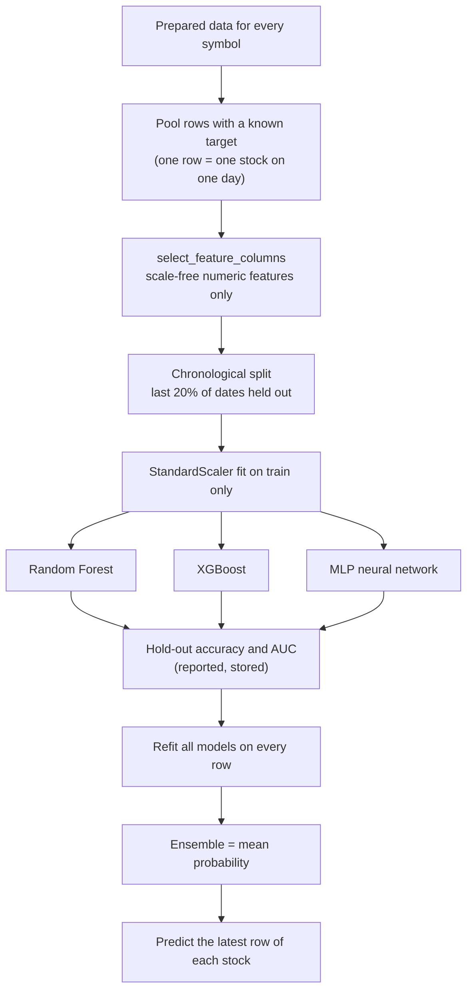
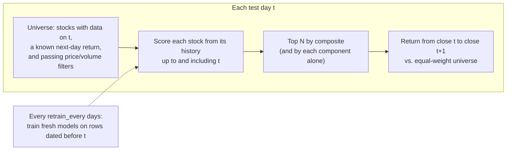

# Architecture

This document describes how the Stock Market Prediction System is built: what each
component does, how data flows through it, how the scores and models work, and how
the backtest checks whether any of it actually works.

- [1. Purpose and scope](#1-purpose-and-scope)
- [2. System overview](#2-system-overview)
- [3. Module map](#3-module-map)
- [4. Daily ranking flow](#4-daily-ranking-flow)
- [5. Feature pipeline](#5-feature-pipeline)
- [6. Scoring model](#6-scoring-model)
- [7. Machine learning design](#7-machine-learning-design)
- [8. Backtest design](#8-backtest-design)
- [9. Data sources, caching and demo mode](#9-data-sources-caching-and-demo-mode)
- [10. Configuration reference](#10-configuration-reference)
- [11. Testing strategy](#11-testing-strategy)
- [12. Design decisions](#12-design-decisions)
- [13. Known limitations](#13-known-limitations)
- [14. Extension points](#14-extension-points)

---

## 1. Purpose and scope

**Goal.** After the market closes, rank a universe of liquid US stocks by how likely each
is to close higher on the next trading day, and present the top N with the reasoning
behind each score.

**What it is.** A research and education tool. It combines rule-based technical scores,
a machine learning ensemble and (optionally) sentiment into one composite score, and it
ships a walk-forward backtest so you can measure whether those scores have any edge.

**What it is not.** It does not place trades, manage a portfolio, or give financial
advice. Next-day stock moves are close to random; the backtest exists precisely so
claims of edge can be checked rather than assumed.

---

## 2. System overview



`StockRanker` is the hub. It owns one instance of each analysis component, reads the
config, and receives its data source by injection. That injection point is what lets
the same code run against live Yahoo Finance data, the synthetic generator, or any
other source that implements the same few methods.

`Backtester` reuses the ranker's scoring rules, filters and ML configuration, so the
backtest measures the exact logic the live system uses rather than a re-implementation.

---

## 3. Module map

| Path | Responsibility | Key types / functions |
|---|---|---|
| `src/data/collector.py` | Fetch OHLCV, company info, news and index data from Yahoo Finance; rate limiting, retries, in-memory caching; config loading | `DataCollector`, `load_config`, `normalize_news_item` |
| `src/data/synthetic.py` | Deterministic synthetic market with an optional planted signal | `generate_market`, `SyntheticDataCollector` |
| `src/data/preprocessor.py` | Clean raw prices; engineer return, volatility, moving-average, momentum, candlestick and support/resistance features; build the target | `DataPreprocessor` |
| `src/analysis/technical_indicators.py` | RSI, MACD, Bollinger Bands, Stochastic, CCI, MFI, ATR, OBV, ADX; chart patterns; signal flags | `TechnicalAnalyzer` |
| `src/analysis/sentiment_analysis.py` | News polarity (TextBlob), VIX-based fear/greed, sector ETF momentum, VIX term proxy | `SentimentAnalyzer` |
| `src/models/ml_models.py` | Feature selection, chronological split, model training, ensemble prediction, persistence | `StockPredictor`, `select_feature_columns` |
| `src/models/evaluation.py` | Classification metrics, single-stock trading metrics, reports | `ModelEvaluator` |
| `src/prediction/stock_ranker.py` | End-to-end ranking: prepare data, filter, train ML once, score, combine, label | `StockRanker`, `composite_score` |
| `src/backtest/backtester.py` | Walk-forward backtest of the daily top-N picks with attribution by component | `Backtester`, `BacktestResult` |
| `src/utils/helpers.py` | Formatting, validation, caching to disk, recommendation labels | `recommendation_label`, `validate_symbols` |
| `src/cli.py` | `analyze`, `single`, `market`, `backtest`, `config` commands | Click group `cli` |
| `web/dashboard.py` | Dash app: analysis, charts, market overview, backtest panel | `app` |
| `main.py` | One-shot ranking of ten large caps with plain-text output | `main` |
| `tests/` | Offline test suite on synthetic data | pytest |

---

## 4. Daily ranking flow



Two details matter:

- **ML is trained once per run, not once per stock.** All symbols' histories are pooled
  (Section 7). The filters decide which stocks are *scored*, but every fetched stock
  contributes training rows.
- **Scoring uses only the latest row.** Each score function reads `data.iloc[-1]` and
  short tails (5 to 20 rows). That property is what lets the backtest call the same
  functions on a history truncated at any past date.

---

## 5. Feature pipeline

`StockRanker.prepare_symbol_data` runs these stages in order for one stock:

| Stage | Adds | Notes |
|---|---|---|
| `clean_stock_data` | – | Drop duplicate dates, sort, forward-fill gaps (never back-fill), replace >50% one-day price jumps with the previous value, replace non-positive volume with the median |
| `add_basic_features` | `Daily_Return`, `Log_Return`, `Volatility_5d/20d`, `Volume_Ratio`, gaps, true range | |
| `add_moving_averages` | `SMA_*`, `EMA_*`, `Price_Above_SMA_*`, `Price_Distance_SMA_*`, MA crosses | periods 5, 10, 20, 50, 200 |
| `add_momentum_features` | `ROC_1d/5d/10d/20d`, `Momentum_*`, `Williams_R_*`, `CCI_*` | |
| `add_pattern_features` | candle body/shadows, doji, hammer, engulfing, higher-highs, `Consecutive_Up_Nd` | |
| `add_support_resistance` | rolling support/resistance, distances, breakouts, `Range_Position` | 20-day window |
| `TechnicalAnalyzer.calculate_all_indicators` | RSI, MACD, Bollinger, Stochastic, CCI, MFI, ATR, OBV, ADX, `*_Pct` versions, signal flags, `Pattern_*` | each indicator computed independently so one failure does not drop the rest |
| `create_target_variable` | `Future_Return`, `Target_Up`, `Target_Direction` | **looks one day ahead**; NaN on the last row |

**Causality rule.** Every feature at date *t* is computed from data at or before *t*.
Only the target columns look forward, and they are excluded from model features by name.
The backtest's "scramble the future" test (Section 11) enforces this.

**Indicator conventions.** RSI uses Wilder's smoothing seeded with a simple average of
the first 14 changes, and is verified against the StockCharts worked example. ADX
counts only the larger of the up/down move. Price-denominated indicators (MACD, ATR,
Bollinger width) also get a percentage-of-price version so they compare across stocks.

**Chart patterns** (double top/bottom, head and shoulders, triangles, bullish flag) are
detected on the latest 20-bar window and stored on the last row only. They describe
"now", not a time series, so they feed the technical score but not the ML features.

---

## 6. Scoring model

Each stock gets up to five component scores on a 0–100 scale.

| Component | Default weight | Inputs | Direction |
|---|---|---|---|
| Technical | 0.30 | RSI zone, MACD vs signal (+ fresh cross), Bollinger position, price vs SMA-20/50, volume ratio, chart patterns | mean-reversion leaning: oversold and near the lower band score high |
| ML prediction | 0.25 | ensemble probability of "closes higher tomorrow" × 100 | |
| Momentum | 0.20 | ROC over 1/5/10/20 days (weights 0.4/0.3/0.2/0.1), 20-day volatility (0.2), up-day streak (0.3) | trend-following: recent gains score high |
| Volume | 0.15 | volume vs 20-day average, 5-day volume trend, price–volume correlation, OBV trend | |
| Sentiment | 0.10 | news polarity (0.4), VIX fear/greed (0.3), sector ETF (0.2), VIX vs its average (0.1) | live only |

Note that the technical score leans towards mean reversion while the momentum score
leans towards trend following. The backtest's per-component attribution shows which
of the two is working on your universe.

**Composite.** A weighted average over the components that are *available*:

```
composite = Σ (weight_i × score_i) / Σ weight_i     over components with a score
```

Renormalising means a missing component (sentiment disabled, no ML model, or sentiment
in a backtest) does not drag every stock towards zero; the remaining weights scale up.

**Model agreement ("ML confidence")** is `1 − 4 × std(individual model probabilities)`,
clipped at 0. It is a measure of agreement, not of calibrated certainty.

**Labels** (`recommendation_label`):

| Label | Rule |
|---|---|
| STRONG BUY | composite ≥ 75 and confidence ≥ 0.7 |
| BUY | composite ≥ 65 and confidence ≥ 0.6 |
| HOLD/WATCH | composite ≥ 55 |
| AVOID | otherwise |

**Filters** applied before scoring: price between `min_price` and `max_price`, 20-day
average volume ≥ `min_volume`, and (live only) market cap ≥ `min_market_cap`
(default $1B).

---

## 7. Machine learning design



**Pooled, cross-sectional training.** One model set learns from every stock at once.
A per-stock model on two years of daily data has about 500 rows and around 75
features; it overfits badly. Pooling 100 stocks gives about 50,000 rows.

**Scale-free features.** Pooling only works if a feature means the same thing for a
$30 stock and a $3,000 stock. `select_feature_columns` drops raw price and volume
levels (`Close`, `SMA_50`, `ATR`, `OBV`, `MACD`, …) and keeps returns, ratios,
oscillators and the `*_Pct` versions. It also drops targets, identifiers and
`Pattern_*` snapshot columns.

**Chronological evaluation.** The hold-out is the most recent 20% of *dates*, never a
random shuffle. Cross-validation uses `TimeSeriesSplit`. A random split would let the
model train on days after the ones it is tested on, which inflates accuracy.

**Evaluate, then refit.** The hold-out run produces the accuracy figures shown to the
user. The models used for prediction are then refit on all rows so they include the
most recent months.

**Models.** Random Forest and XGBoost are shallow and regularised (depth 6 and 3, at
least 20 rows per leaf for the forest) because the signal-to-noise ratio is very low.
The neural network is scikit-learn's `MLPClassifier` with early stopping, which avoids
a TensorFlow dependency. An LSTM is available behind `ml_config.models.lstm.enabled`
(requires TensorFlow); it trains on per-stock sequences and is excluded from the
ensemble probability.

**Target.** `Target_Up = 1` when tomorrow's close exceeds today's by more than
`training.target_threshold` (default 0, so roughly balanced classes). Expect hold-out
accuracy near the base rate on real data; a few points above it is a meaningful result.

---

## 8. Backtest design

The backtest answers one question: *if I had bought the top N stocks at each close and
sold them at the next close, would I have beaten simply holding all of them equally?*



**Walk-forward ML.** Models are retrained every `retrain_every` test days (default 20)
on pooled rows dated strictly before *t*. A row dated *d* has a label that depends on
the close of *d + 1*. For every *d < t* that close is known at the close of *t*, so no
future information enters training. No hold-out or cross-validation is done inside the
backtest; the backtest itself is the out-of-sample test.

**Execution model.** Buy at the close of *t*, sell at the close of *t + 1*, equal weight.
Transaction costs are charged on turnover: the share of the portfolio that changes from
one day to the next, times two one-way costs (`cost_bps`, default 5 bp). The first day
pays one-way only.

**Sentiment is excluded** because historical news and sector snapshots are not
available for past dates. The composite renormalises over the other weights, so the
backtest measures the price-based and ML parts of the score.

**Attribution.** Alongside the composite, the backtest picks the top N by each
component on its own (technical, momentum, volume, ML). That shows which parts of the
score carry signal and which add noise.

**Metrics** (per strategy, computed on daily returns):

| Metric | Definition |
|---|---|
| Total / annualized return | compounded daily returns; annualized over 252 days |
| Sharpe | annualized mean ÷ annualized volatility (risk-free rate 0) |
| Max drawdown | worst peak-to-trough fall in the equity curve |
| Excess/day | mean of (strategy − universe) daily return, in basis points |
| t-stat | mean excess ÷ standard error; between −2 and 2 the difference is plausibly luck |
| Days beating universe | share of days the strategy's return exceeded the universe's |

**Outputs.** `BacktestResult.daily` (one row per day), `.picks` (every pick with its
score and realized return), `.metrics`, plus CSV files and an interactive HTML chart
written by the CLI, and a chart and table in the dashboard.

---

## 9. Data sources, caching and demo mode

**Yahoo Finance via `yfinance`** is the only required source. `DataCollector`:

- spaces requests by `api_config.rate_limits.yfinance` per hour (default 7,200, i.e. 0.5 s),
- retries failed history requests with exponential backoff (`retry_attempts`),
- caches price history for 15 minutes and company info for the life of the collector,
- strips timezones and normalises dates so stocks align on the same calendar,
- normalises both the old and the nested (2025+) `yfinance` news formats.

`SentimentAnalyzer` caches sector ETF scores, the VIX fear/greed proxy and the VIX
ratio once per day, so analysing 100 stocks costs one set of index requests, not 100.

Alpha Vantage clients are created when `ALPHA_VANTAGE_API_KEY` is set but are not used
by the ranking pipeline today.

**Demo mode (`--demo`, dashboard checkbox).** Uses `SyntheticDataCollector`: a
one-factor market (shared market return × beta + idiosyncratic noise) with a mild
planted mean-reversion signal. It needs no network and is deterministic. It exists for
trying the interface and for tests; its numbers say nothing about real markets.

---

## 10. Configuration reference

All settings live in `config/config.yaml`. Relative paths resolve from the working
directory first, then from the project root.

| Section | Key | Default | Effect |
|---|---|---|---|
| `stock_config` | `symbols` | ~100 S&P 500 names | default universe |
| | `timeframe` | `2y` | history fetched for ranking |
| `technical_analysis.indicators` | `rsi`, `macd`, `bollinger_bands`, … | standard periods | indicator parameters; missing ones use defaults |
| `ml_config.models` | `random_forest`, `xgboost`, `neural_network`, `lstm` | see file | hyperparameters; `enabled: false` turns a model off |
| `ml_config.training` | `test_size` | 0.2 | hold-out fraction of dates for reported accuracy |
| | `cross_validate`, `cv_splits` | true, 3 | time-series CV on the training part |
| | `min_samples` | 200 | minimum pooled rows to train |
| | `target_threshold` | 0.0 | minimum next-day return counted as "up" |
| `ranking_config` | `weights` | 0.30 / 0.25 / 0.20 / 0.15 / 0.10 | composite weights (renormalised) |
| | `filters` | $5–$1,000, 1M shares/day | universe filters |
| | `top_picks` | 10 | default N |
| | `use_sentiment` | true | turn off to skip all news/sector/VIX requests |
| `backtest` | `period` | `2y` | history fetched for backtests |
| | `test_days` | 120 | days simulated |
| | `retrain_every` | 20 | days between ML retrains |
| | `min_train_days` | 120 | history needed before the first model |
| | `cost_bps` | 5 | one-way cost in basis points |
| `api_config` | `rate_limits`, `retry_attempts` | 7,200/h, 3 | network behaviour |

---

## 11. Testing strategy

The suite in `tests/` runs offline in about a minute and a half. It uses the synthetic
collector and a config copy with small models.

| File | Covers |
|---|---|
| `test_data.py` | cleaning (no back-fill, spike repair), feature values, target alignment, synthetic generator, news normalisation |
| `test_indicators.py` | YAML config shape, every indicator present, RSI against published Wilder values, band ordering, ADX direction, pattern snapshot, scale-free flag detection |
| `test_models.py` | feature selection excludes leaks and price levels, chronological split, models learn a planted signal, robust to column order, refit, persistence |
| `test_ranker.py` | end-to-end ranking, score ranges, momentum not saturated, composite renormalisation, filters, labels, CSV export |
| `test_backtest.py` | result structure, pick returns match data, **no lookahead**, no edge on noise, edge found on planted signal |
| `test_helpers.py` | utilities; one live Yahoo test, skipped unless `RUN_NETWORK_TESTS=1` |

**Lookahead is tested two independent ways:**

1. *Scramble the future.* Prices after a cutoff date are replaced with random paths.
   Every pick made before the cutoff must be identical, with and without ML.
2. *Noise in, nothing out.* On data with no signal, no strategy may show a significant
   excess return. On data with a planted signal, the ML strategy must find it.

GitHub Actions (`.github/workflows/tests.yml`) runs the suite on Python 3.10, 3.12 and
3.13 for every push and pull request.

---

## 12. Design decisions

| Decision | Alternative considered | Why |
|---|---|---|
| Pool all stocks into one model | one model per stock | ~100× more training rows; per-stock models on ~500 rows overfit |
| Scale-free features only | all numeric columns | raw price levels are meaningless across stocks and leak identity |
| Chronological split and `TimeSeriesSplit` | shuffled split | shuffled splits test on the past using the future |
| Evaluate on hold-out, then refit on all data | predict with the hold-out model | the hold-out model would ignore the most recent months |
| scikit-learn MLP | Keras dense network | same role, no TensorFlow install (which lags new Python versions) |
| Renormalised composite | fixed weights with neutral fill-ins | a missing component should not shift every score |
| Inject the data source into `StockRanker` | hard-wired `DataCollector` | enables offline tests, demo mode, other providers |
| Backtest reuses ranker scoring functions | separate backtest logic | measures exactly what the live system does |
| Patterns as latest-row snapshot | per-row pattern history | detection is defined on the latest window; broadcasting it backwards leaked the present into the past |

---

## 13. Known limitations

- **Survivorship bias.** The default universe is today's large caps. Backtesting it
  over past years excludes companies that fell out of the index, which flatters results.
- **Close-to-close fills.** Real fills at the close are not guaranteed and the fixed
  per-trade cost ignores spread and market impact.
- **Sentiment is not backtested** (no point-in-time news archive).
- **Market-cap filter is live-only**; historical market caps are not fetched.
- **`yfinance` is unofficial.** Yahoo can change or throttle it; the collector retries
  and degrades to skipping symbols.
- **Short-horizon prediction is hard.** Expect ML accuracy within a few points of the
  base rate on real data; use the backtest's t-statistics before trusting any score.

---

## 14. Extension points

- **New data source:** implement `fetch_multiple_stocks`, `fetch_stock_data`,
  `fetch_company_info`, `fetch_market_data` and `get_stock_news` (see
  `SyntheticDataCollector`) and pass it as `StockRanker(data_collector=...)`.
- **New indicator:** add a method to `TechnicalAnalyzer` and register it in
  `calculate_all_indicators`. If it is price-denominated, also add a `*_Pct` version
  so it can be used as an ML feature.
- **New score component:** add a `calculate_*_score` method, include it in
  `score_components`, and give it a weight in `ranking_config.weights`. The backtest
  picks it up automatically for attribution.
- **New model:** add a `train_*` method and a config block in `StockPredictor`; any
  classifier with `predict_proba` joins the ensemble.
