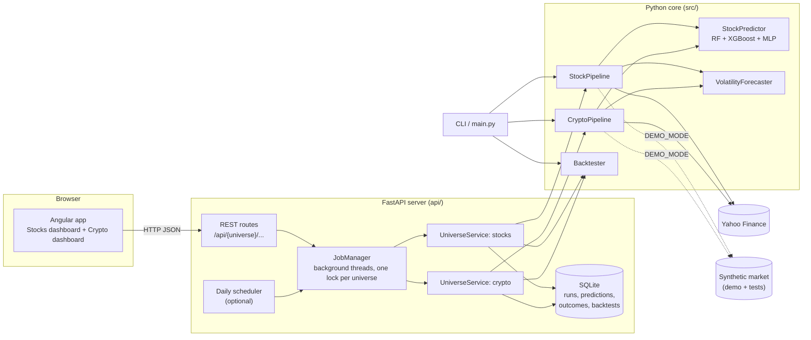
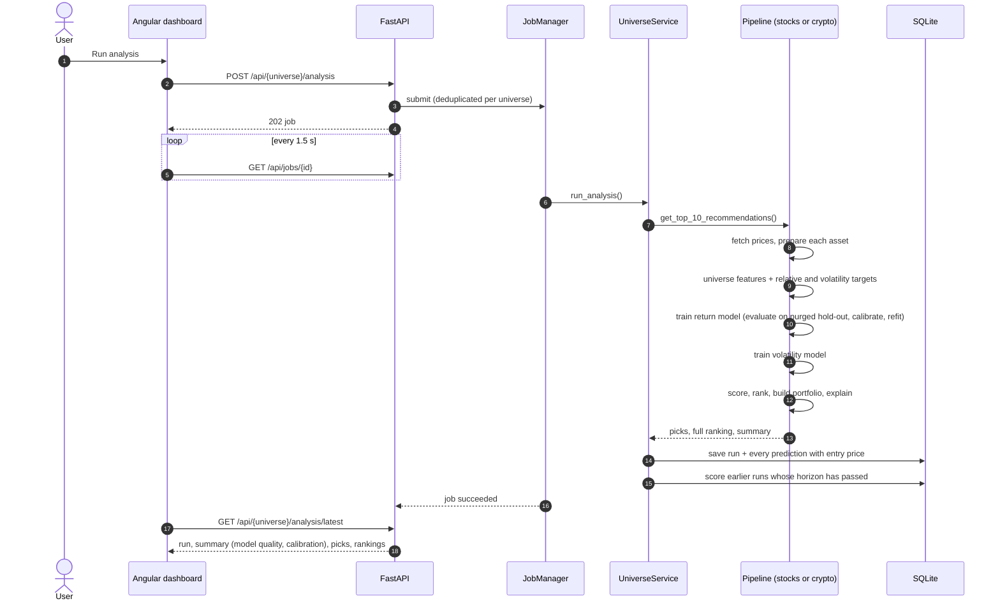
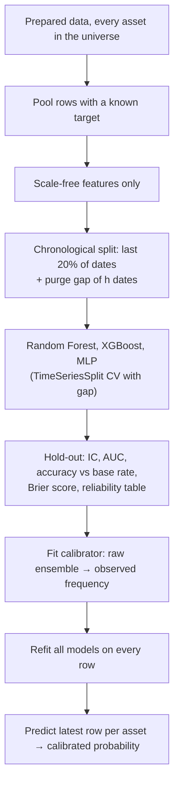
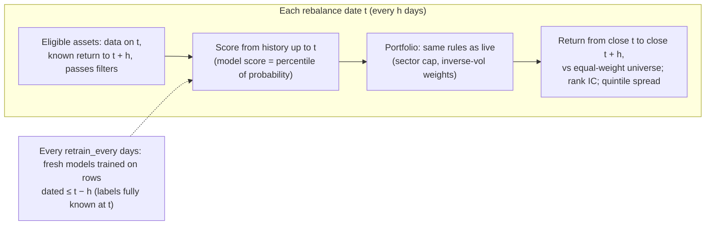
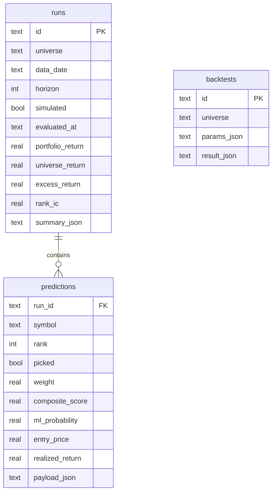

# Architecture

Ledger ranks US stocks and crypto by how likely each is to beat the rest of its
market over the next few days, and shows, at every step, how much evidence there
is that the ranking works. This document describes how it is built.

- [1. Purpose and scope](#1-purpose-and-scope)
- [2. System overview](#2-system-overview)
- [3. Module map](#3-module-map)
- [4. Two pipelines: stocks and crypto](#4-two-pipelines-stocks-and-crypto)
- [5. Analysis flow](#5-analysis-flow)
- [6. Feature pipeline and targets](#6-feature-pipeline-and-targets)
- [7. Scoring and portfolio construction](#7-scoring-and-portfolio-construction)
- [8. Return model](#8-return-model)
- [9. Volatility model](#9-volatility-model)
- [10. Backtest design](#10-backtest-design)
- [11. Track record](#11-track-record)
- [12. API](#12-api)
- [13. Frontend](#13-frontend)
- [14. Data sources, demo mode and deployment](#14-data-sources-demo-mode-and-deployment)
- [15. Configuration reference](#15-configuration-reference)
- [16. Testing strategy](#16-testing-strategy)
- [17. Design decisions](#17-design-decisions)
- [18. Known limitations](#18-known-limitations)
- [19. Extension points](#19-extension-points)

---

## 1. Purpose and scope

**Goal.** For each asset class, rank the universe by the probability of beating
the universe's average return over the next *h* days (default 5), build a
risk-aware portfolio from the top of the ranking, and make the evidence for or
against the model's skill impossible to miss.

**Principles.**

- *Measure what matters.* The headline metric is the out-of-sample rank
  information coefficient (IC), not accuracy. For short-horizon returns an IC of
  0.03–0.05 is good; next-day direction accuracy above 60% almost always means a
  bug.
- *Never peek.* Every feature, every training set and every backtest decision
  uses only data available at that moment. This is enforced by tests.
- *Separate what is different.* Stocks and crypto have separate pipelines,
  models, settings, dashboards and records.
- *Predict what is predictable.* Volatility is far more forecastable than
  direction, so it gets its own model and page.

**Not in scope.** Placing trades, managing real money, or giving financial advice.

---

## 2. System overview



The **Python core** (`src/`) contains all prediction logic and works on its own
through the CLI. The **API** (`api/`) wraps it with background jobs, persistence
and JSON endpoints. The **frontend** (`frontend/`) is an Angular single-page app
that only talks to the API. In production the API also serves the built
frontend, so one process and one port run the whole app.

---

## 3. Module map

| Path | Responsibility | Key types |
|---|---|---|
| `src/data/collector.py` | Yahoo Finance access: prices, company info, news, indices; rate limiting, retries, caching; config loading | `DataCollector`, `load_config` |
| `src/data/synthetic.py` | Deterministic synthetic markets (stocks or 7-day crypto) with GARCH volatility and an optional planted signal | `generate_market`, `SyntheticDataCollector` |
| `src/data/preprocessor.py` | Cleaning; return, volatility, moving-average, momentum, candlestick and support/resistance features; absolute, relative and volatility targets | `DataPreprocessor`, `add_relative_targets` |
| `src/analysis/technical_indicators.py` | RSI (Wilder), MACD, Bollinger, Stochastic, CCI, MFI, ATR, OBV, ADX, chart patterns, signal flags | `TechnicalAnalyzer` |
| `src/analysis/sentiment_analysis.py` | News polarity, VIX fear/greed, sector ETFs (stocks only) | `SentimentAnalyzer` |
| `src/models/ml_models.py` | Feature selection, purged chronological split, models, calibration, IC, SHAP explanations | `StockPredictor`, `information_coefficient` |
| `src/models/volatility.py` | Forward-volatility classifier and regressor with naive baseline | `VolatilityForecaster` |
| `src/prediction/stock_ranker.py` | Shared pipeline: prepare → train → score → rank → portfolio | `StockRanker`, `composite_score` |
| `src/prediction/pipelines.py` | Asset-class pipelines and factory | `StockPipeline`, `CryptoPipeline`, `create_pipeline` |
| `src/prediction/portfolio.py` | Sector cap and inverse-volatility weights | `select_portfolio` |
| `src/backtest/backtester.py` | Walk-forward, purged, horizon-aware backtest with IC and attribution | `Backtester`, `BacktestResult` |
| `src/cli.py`, `main.py` | Command-line entry points (`--universe stocks|crypto`) | |
| `api/main.py` | FastAPI app, routes, scheduler, static frontend | `create_app` |
| `api/service.py` | Per-universe orchestration: analysis, outcomes, backtests, page data | `UniverseService` |
| `api/store.py` | SQLite schema and queries | `Store` |
| `api/jobs.py` | Background job runner with per-universe locks | `JobManager` |
| `frontend/src/app/` | Angular app: shell, per-dashboard layout, pages, shared components | see §13 |

---

## 4. Two pipelines: stocks and crypto

`StockRanker` holds everything shared. `StockPipeline` and `CryptoPipeline`
subclass it, and `create_pipeline(universe)` returns the right one. Each
instance owns its own `StockPredictor` and `VolatilityForecaster`, saves its
models to its own file (`data/models/{universe}.joblib`), and writes its own
runs to the database, so nothing learned on one asset class affects the other.

| | Stocks | Crypto |
|---|---|---|
| Universe | ~100 liquid S&P 500 names | 22 major coins (`BTC-USD`, …) |
| Calendar | trading days, 252 per year | every day, 365 per year |
| Extra features | return vs. the average stock (5d, 20d), 20-day return rank | return vs. Bitcoin (5d, 20d), 30-day beta and correlation to Bitcoin, Bitcoin's own 5-day return |
| Grouping | sector (Yahoo Finance) | category (store of value, smart-contract platform, payments, DeFi, …) |
| Portfolio | max 3 per sector, inverse-volatility weights | no category cap, inverse-volatility weights |
| Filters | price ≥ $5, ≥ 1M shares/day, cap ≥ $1B | ≥ $10M/day volume, cap ≥ $1B; any price |
| Sentiment | news, VIX, sector ETFs | off (VIX and sector ETFs do not apply) |
| Market header | S&P 500, Nasdaq, Dow, VIX, gold, bonds | BTC, ETH, SOL |
| Suggested cost | 5 bp per trade | 10–20 bp per trade |

Both share the indicator set, the scoring rules, the model architecture and the
backtest engine, which keeps results comparable and the code small.

---

## 5. Analysis flow



Jobs run on a two-thread pool with one lock per universe: a stock job and a
crypto job run in parallel; two jobs on the same universe queue. Starting an
analysis that is already running returns the existing job.

---

## 6. Feature pipeline and targets

`prepare_symbol_data` runs per asset; `prepare_universe` then adds features and
targets that need the whole universe.

| Stage | Adds |
|---|---|
| Clean | drop duplicate dates, forward-fill gaps (never back-fill), repair >50% one-day spikes, fix non-positive volume |
| Basic features | returns, 5/20/60-day volatility, short/long volatility ratio, absolute return, range, volume ratio, gaps |
| Moving averages | SMA/EMA 5–200, price vs. average, distance from average, crosses |
| Momentum | rate of change 1/5/10/20 days, Williams %R, CCI |
| Candles | body and shadows, doji, hammer, engulfing, streaks |
| Support/resistance | 20-day range, distances, breakouts |
| Indicators | RSI, MACD, Bollinger, Stochastic, MFI, ATR, OBV, ADX, `*_Pct` scale-free versions, chart patterns (latest row only) |
| Targets | `Future_Return` over *h* days, `Target_Up`; `Future_Vol` and `Target_Vol_Up` over 5 days |
| Universe | `Future_Excess` and `Target_Up_Rel` (return minus the equal-weight universe average), market volatility and return, asset-class features (§4) |

**Why a relative target.** On any given day most stocks move with the market,
and no stock-level feature predicts the market. Subtracting the universe average
removes that unpredictable common move and leaves exactly what a ranking can
exploit. It also makes the classes balanced (about half beat the average).

**Causality.** Every feature at date *t* uses data up to *t*. Targets look
forward and are excluded from features by name; the "scramble the future" test
(§16) enforces this end to end.

---

## 7. Scoring and portfolio construction

Each asset gets component scores on 0–100:

| Component | Default weight | How |
|---|---|---|
| Model | 0.35 | cross-sectional percentile of the calibrated probability (best asset = 100) |
| Technical | 0.25 | rules on RSI, MACD, Bollinger position, moving averages, volume, chart patterns |
| Momentum | 0.20 | weighted rate of change, volatility and up-day streaks |
| Volume | 0.10 | volume vs. average, volume trend, price–volume agreement, OBV trend |
| Sentiment | 0.10 | stocks only, live only |

The model score is a percentile rather than the raw probability because
probabilities for relative returns cluster near 50%; ranking them spreads the
score across 0–100 so the weight means what it says.

The **composite** is a weighted average over the components that exist,
renormalised so a missing component (sentiment for crypto, or in a backtest)
does not drag scores down.

**Portfolio** (`select_portfolio`): take assets in composite order, skipping any
that would exceed the per-sector cap, until *N* are chosen; then weight them in
proportion to 1 / volatility so each contributes similar risk.

**Explanations.** For each asset the API returns the plain-language signals
(e.g. "RSI 27: oversold") and the XGBoost model's exact SHAP contributions per
feature (log-odds), so the dashboard can show what pushed a score up or down.

---

## 8. Return model



- **Pooled training.** One model per universe learns from all its assets
  (about 50,000 rows for stocks over two years) rather than ~500 rows per asset.
- **Scale-free features.** Raw prices and volumes are excluded so assets at
  different price levels are comparable.
- **Purged split.** Labels look *h* days ahead, so the last *h* dates before the
  test period are dropped from training; otherwise their labels would overlap
  the test period. Cross-validation uses `TimeSeriesSplit(gap=h)`.
- **Calibration.** A logistic (Platt) calibrator fitted on the hold-out maps the
  raw ensemble output to the frequency actually observed, so "55%" means 55%.
  The dashboard plots the reliability table.
- **IC.** For every hold-out date, the Spearman correlation between predicted
  probability and realised excess return across assets; reported as mean,
  standard deviation, t-statistic and share of positive dates.
- **Refit.** The evaluated models never see the most recent months; the models
  used for today's prediction are refit on everything.

---

## 9. Volatility model

Volatility clusters: big moves follow big moves. `VolatilityForecaster` pools the
universe and fits two gradient-boosted models on volatility features (5/20/60-day
volatility and their ratio, range, ATR, Bollinger width, recent returns, market
volatility):

- a **classifier** for "will the next 5 days' realised volatility exceed the
  trailing 20-day level?", reported as accuracy against the majority-class rate
  and AUC;
- a **regressor** for log future volatility, reported as R² against the naive
  forecast "volatility stays at its 20-day level".

Both are evaluated on a purged chronological hold-out, then refit. On real data
this kind of model typically reaches 65–75% accuracy, which is honest skill
rather than an artefact. On the synthetic demo market it reaches about 60%.

---

## 10. Backtest design



- **Holding periods** are non-overlapping blocks of *h* days, annualised with
  `periods_per_year / h` (252 for stocks, 365 for crypto).
- **Costs** are charged on actual weight changes: Σ|w_new − w_old| × cost.
- **Attribution.** Alongside the composite, the top *N* by each component alone
  (technical, momentum, volume, model), to show which parts carry signal.
- **Metrics.** Total and annualised return, volatility, Sharpe, maximum drawdown,
  average excess per period, excess t-statistic, share of periods beating the
  universe; and per score: mean rank IC, t-statistic, share positive, annualised
  information ratio.
- **Sentiment is excluded** (no point-in-time news archive).

---

## 11. Track record

Every API analysis stores the full ranking with entry prices before the outcome
exists. `evaluate_outcomes` runs after each analysis (and on demand): for every
run whose horizon has passed it computes each asset's realised return from its
own price history, then the portfolio's return, the universe average, the excess
and the rank IC. The Track record page summarises these with a t-statistic and a
cumulative chart.

In demo mode, a fresh database is seeded with a walk-forward backtest whose
periods are stored as **simulated** runs and always labelled as such; they never
appear as live predictions.



---

## 12. API

Interactive documentation is served at `/api/docs`. Every asset-class endpoint
takes `{universe}` = `stocks` or `crypto`.

| Method | Path | Purpose |
|---|---|---|
| GET | `/api/health` | status, version, demo flag |
| GET | `/api/universes` | both universes' settings |
| GET | `/api/{universe}` | one universe's settings and last run time |
| POST | `/api/{universe}/analysis` | start an analysis job (`top_n`, `symbols` optional) |
| GET | `/api/{universe}/analysis/latest` | latest live run: summary, model quality, calibration, picks, ranking |
| GET | `/api/{universe}/runs`, `/runs/{id}` | run history and detail with outcomes |
| GET | `/api/{universe}/assets/{symbol}` | 250 days of price and indicators, latest standing, reasons |
| GET | `/api/{universe}/volatility` | volatility model skill and per-asset forecasts |
| GET | `/api/{universe}/market` | benchmark moves for the header |
| GET | `/api/{universe}/track-record` | live and simulated summaries, curves, runs |
| POST | `/api/{universe}/track-record/evaluate` | score matured runs now |
| POST | `/api/{universe}/backtests` | start a backtest job (`top_n`, `test_days`, `retrain_every`, `cost_bps`, `use_ml`) |
| GET | `/api/{universe}/backtests`, `/backtests/{id}` | saved backtests and full results |
| GET | `/api/jobs`, `/api/jobs/{id}` | job status for polling |

Server settings come from environment variables (`api/settings.py`):
`CONFIG_PATH`, `DEMO_MODE`, `DATABASE_PATH`, `FRONTEND_DIST`, `CORS_ORIGINS`,
`SEED_DEMO`.

---

## 13. Frontend

Angular 22, standalone components, signals for state, lazy-loaded pages,
Chart.js for charts, no UI kit.

```
frontend/src/app/
├── app.ts / app.html            Shell: navigation rail with both dashboards
├── app.routes.ts                /stocks/... and /crypto/... share one set of page routes
├── core/
│   ├── api.service.ts           Typed HTTP client, job polling
│   ├── universe-store.ts        One signal store per dashboard (no shared state)
│   ├── models.ts                API response types
│   ├── format.ts                Number formatting, t-statistic → plain verdict
│   └── route-universe.ts        Which dashboard a route belongs to
├── shared/
│   ├── evidence-meter.ts        Out-of-sample IC on a scale with the luck band shaded
│   ├── chart.ts                 Chart.js wrapper, theme-aware colours
│   └── score-bar.ts
└── pages/
    ├── universe-layout.ts       Dashboard header, benchmarks, run button, accent colour
    ├── outlook.*                Evidence, portfolio with reasons, full ranking, model facts, calibration
    ├── backtest.ts/html         Settings, verdict, equity curves, metrics, IC, recent picks
    ├── track-record.ts          Live vs simulated record
    ├── volatility.ts            Forecasts vs current volatility
    └── asset.ts                 Price with band, RSI, standing, reasons
```

**Two dashboards.** `/stocks` and `/crypto` render the same page components,
but each gets its own `UniverseStore`, its own API namespace and its own accent
colour (cobalt for stocks, violet for crypto), so they read as separate products
that share a design language.

**Design.** Graph-paper neutrals and slate ink; green and crimson are reserved
for outperformance and underperformance. Public Sans (self-hosted) with tabular
figures. The evidence meter leads each dashboard so the strength of the evidence
is the first thing a reader sees. Light and dark themes follow the system
setting; keyboard focus is visible; motion is limited to a loading spinner and
respects reduced-motion settings.

In development `ng serve` proxies `/api` to `http://127.0.0.1:8000`
(`proxy.conf.json`). In production the FastAPI server serves the built files and
falls back to `index.html` for client-side routes.

---

## 14. Data sources, demo mode and deployment

**Yahoo Finance via `yfinance`** is the only required source: prices for stocks
and coins (`BTC-USD`), company info, news and index levels. The collector rate
limits (default 0.5 s between requests), retries with backoff, caches price
history for 15 minutes and company info per process, and normalises dates to a
timezone-free calendar.

**Demo mode** (`DEMO_MODE=true`, or `--demo` on the CLI) swaps in the synthetic
market: one-factor returns with GARCH volatility clustering and a mild planted
mean-reversion signal; crypto symbols get a 7-day calendar and higher volatility
around a Bitcoin-driven factor. It needs no network, is deterministic, and seeds
both dashboards on first start. Its numbers say nothing about real markets.

**Deployment.** The `Dockerfile` builds the Angular app in a Node stage and runs
it from the FastAPI server in a Python stage; `docker compose up --build` starts
it on port 8000 with a volume for the database and saved models. Any host that
runs a container works (Render, Railway, Fly.io, Hugging Face Spaces, a VM).
Hosted servers are often throttled by Yahoo Finance, so demo mode is the
reliable choice for a public demo.

---

## 15. Configuration reference

All settings are in `config/config.yaml`.

| Section | Key | Default | Effect |
|---|---|---|---|
| `universes.{stocks,crypto}` | `symbols` | see file | the universe |
| | `timeframe` | `2y` | history fetched |
| | `periods_per_year` | 252 / 365 | annualisation |
| | `use_sentiment` | true / false | news, VIX and sector sentiment |
| | `filters` | see §4 | price, volume, market cap |
| | `portfolio.max_per_sector` | 3 / 0 | sector cap (0 = none) |
| | `portfolio.weighting` | `inverse_volatility` | or `equal` |
| `technical_analysis.indicators` | `rsi`, `macd`, … | standard | indicator periods |
| `ml_config.models` | `random_forest`, `xgboost`, `neural_network`, `lstm` | see file | hyperparameters; `enabled: false` disables |
| `ml_config.training` | `target` | `relative` | or `absolute` |
| | `horizon` | 5 | days ahead |
| | `test_size` | 0.2 | hold-out share of dates |
| | `calibrate` | true | Platt calibration on the hold-out |
| | `cross_validate`, `cv_splits` | true, 3 | time-series CV with purge gap |
| `volatility` | `enabled`, `horizon` | true, 5 | volatility model |
| `ranking_config` | `weights`, `top_picks` | see §7, 10 | composite weights, portfolio size |
| `backtest` | `period`, `test_days`, `retrain_every`, `min_train_days`, `cost_bps` | 2y, 120, 20, 120, 5 | backtest defaults |
| `tracking` | `database` | `data/predictions.db` | SQLite file |
| `scheduler` | `enabled`, `time`, `universes` | false, 22:30, both | daily automatic analysis in the API |
| `api_config` | `rate_limits`, `retry_attempts` | 7,200/h, 3 | Yahoo Finance behaviour |

---

## 16. Testing strategy

| Suite | Runs | Covers |
|---|---|---|
| `tests/` (pytest) | offline, ~2 min | data, indicators, models, both pipelines, portfolio, backtest, API |
| `frontend/` (Vitest + jsdom) | offline, seconds | formatting, evidence meter, every page for both dashboards, rendered from real API responses captured in demo mode |

Key checks:

- **No lookahead, twice over.** (1) Scrambling every price after a cutoff
  leaves every pick decided before the cutoff unchanged, with and without the
  model. (2) On data with no signal no strategy shows significant edge, while on
  data with a planted signal the model finds it (IC t > 3).
- **Methodology.** Purge gap size; relative targets sum to zero across the
  universe; calibration does not worsen the Brier score; SHAP contributions plus
  the bias equal the model's output; the volatility model beats the naive
  forecast on clustered data; RSI matches the published Wilder example.
- **Separation.** Stock and crypto pipelines have distinct models, model files,
  calendars and symbols; the crypto dashboard renders only crypto.
- **API.** Full job lifecycle, deduplication, outcome scoring against known
  prices, simulated runs never replacing live ones, validation errors.

CI (`.github/workflows/tests.yml`) runs the Python suite on 3.10, 3.12 and 3.13
and the frontend tests and production build on Node 22.

---

## 17. Design decisions

| Decision | Alternative | Why |
|---|---|---|
| Relative target over 5 days | absolute next-day direction | removes the unpredictable market move; signals persist longer than one day |
| IC as the headline metric | accuracy | measures ranking quality, which is what the product does; accuracy is misleading near 50% |
| Purged split and walk-forward retraining | random split | overlapping labels leak the future into training |
| Calibrated probabilities | raw model output | a displayed probability should mean what it says |
| Model score as a percentile | raw probability × 100 | relative-return probabilities cluster near 50% |
| Separate pipelines per asset class | one model for everything | different calendars, volatility and drivers; "beat the field" only makes sense within one market |
| Inverse-volatility weights, sector cap | equal weights | stops one volatile asset or one sector dominating the result |
| Jobs + polling | synchronous requests | training takes minutes; requests would time out |
| SQLite | a database server | single file, zero setup, enough for one user's history |
| Angular with signals, no UI kit | component library | the design is specific to this product and the bundle stays small (≈80 kB initial) |
| Self-hosted font | Google Fonts | works offline and in locked-down deployments, no third-party requests |

---

## 18. Known limitations

- **Survivorship bias.** Universes are today's large assets; backtests over past
  years exclude those that fell away, which flatters results.
- **Free data.** No fundamentals, estimates, options or order-book data; those
  are where most real edge comes from.
- **Execution.** Close-to-close fills with a fixed cost; no spread, impact or
  borrow costs.
- **Sentiment** is live-only and stocks-only.
- **`yfinance` is unofficial**; Yahoo may throttle or change it.
- **Demo numbers are synthetic** and say nothing about real markets.

---

## 19. Extension points

- **New asset class:** subclass `StockRanker` in `pipelines.py`, add
  `add_universe_features` and `asset_metadata`, register it in `PIPELINES`, and
  add a `universes` entry in the config. The API, backtest and frontend pick it
  up by key (add a navigation entry in `app.ts` and routes in `app.routes.ts`).
- **New data source:** implement the `DataCollector` methods used by the
  pipeline (see `SyntheticDataCollector`) and pass it to `create_pipeline`.
- **New feature:** compute it in the preprocessor, indicators or
  `add_universe_features`; if scale-free it becomes a model input automatically.
  Add a readable name to `FEATURE_LABELS` for explanations.
- **New model:** add a trainer and config block in `StockPredictor`; any
  classifier with `predict_proba` joins the ensemble and calibration.
