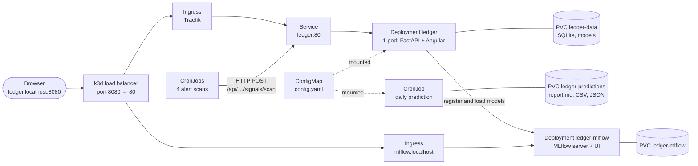

# Ledger on Kubernetes

Ledger can run on a local Kubernetes cluster, deployed with a Helm chart. It
is the same app as `./run.sh` starts; this way of running it is for learning
and practising the tools used to run services in production: containers,
Kubernetes objects, Helm releases, health probes, persistent volumes and
scheduled jobs.

```bash
./kube.sh up            # then open http://ledger.localhost:8080
```

## What you need

A Linux machine with about 4 free CPU cores and 6 GB of free memory (the
laptop profile), and Docker. On Arch-based systems (CachyOS, Manjaro…)
`kube.sh` installs everything that is missing:

| Tool | What it is | Installed with |
|---|---|---|
| Docker | runs containers; the cluster itself runs inside Docker | pacman |
| k3d | creates a k3s cluster (a small, complete Kubernetes) inside Docker | its install script, into `~/.local/bin` |
| kubectl | the Kubernetes command line | pacman |
| Helm | installs and upgrades the app from its chart | pacman |

The first time, `kube.sh` may add you to the `docker` group and ask you to log
out and back in, because k3d must use Docker without sudo.

## Commands

| Command | What it does |
|---|---|
| `./kube.sh up` | Update from GitHub, create the cluster if needed, build the image, deploy, wait until ready, open the browser |
| `./kube.sh up --live` | The same with real Yahoo Finance prices |
| `./kube.sh up --profile desktop` | Bigger resource limits (see the profiles below) |
| `./kube.sh up --monitoring` | Also deploy Prometheus and Grafana; later runs keep them until `--no-monitoring` |
| `./kube.sh status` | Release, pods, scheduled jobs, recent job runs, volumes |
| `./kube.sh logs` | Follow the server's logs (`logs mlflow`, `logs scans` or `logs prediction` for the others) |
| `./kube.sh predict-now` | Run the daily prediction job now and follow its output |
| `./kube.sh results [DIR]` | Copy the latest prediction results to `./results` (or DIR) |
| `./kube.sh test` | Run the chart's tests against the running app (`helm test`) |
| `./kube.sh down` | Uninstall the app, keeping its data |
| `./kube.sh destroy` | Delete the cluster and everything in it |

Like `run.sh`, `kube.sh up` first fast-forwards to the latest `main` on GitHub
(never overwriting local changes), so after merging a pull request, running
`./kube.sh up` again deploys the new version. Each build is tagged with its
commit, so Helm sees a new image and Kubernetes replaces the pod.
`--no-update` deploys what you have; `--branch NAME` follows another branch.

`kube.sh` only ever talks to its own cluster (kubectl context `k3d-ledger`).
Other clusters in your kubeconfig, for example from work, are never touched,
and your current context is not changed.

## What gets deployed



| Object | Name | Why |
|---|---|---|
| Namespace | `ledger` | keeps everything of the app together |
| Deployment | `ledger` | the web server; Kubernetes restarts it if it crashes or hangs |
| Service | `ledger` | a stable in-cluster address for the pod |
| Ingress | `ledger` | routes `http://ledger.localhost` to the Service |
| ConfigMap | `ledger-config` | `config/config.yaml`, mounted at `/etc/ledger` |
| Secret | `ledger` | only when `ALPHA_VANTAGE_API_KEY` is set |
| PersistentVolumeClaim | `ledger-data` | the database and saved models, kept across restarts and upgrades |
| PersistentVolumeClaim | `ledger-predictions` | one folder per day of daily prediction results |
| CronJob | `ledger-scan-stocks-open`, `…-stocks-close`, `…-crypto-open`, `…-crypto-close` | the twice-daily alert scans, at 09:45 and 16:15 New York time |
| Deployment, Service, Ingress | `ledger-mlflow` | MLflow server: training runs, model versions, web UI at `http://mlflow.localhost:8080` |
| PersistentVolumeClaim | `ledger-mlflow` | MLflow's database and model files |
| Deployments, Services, Ingresses | `ledger-prometheus`, `ledger-grafana` | With `--monitoring`: metrics and alert rules, and the Ledger dashboard |
| CronJob | `ledger-daily-prediction` | `scripts/daily_prediction.py` at 17:30 New York time |
| Pod (test hook) | `ledger-test` | run by `helm test`: checks readiness, the web app and both dashboards |

### Design choices worth knowing

- **One replica, `Recreate` strategy.** The app keeps its data in SQLite and
  runs long jobs (training, backtests) inside the server process, so only one
  copy may run at a time. The chart refuses `replicaCount` other than 1, and an
  upgrade stops the old pod before starting the new one. Scaling out would mean
  moving to PostgreSQL and a job queue first.
- **Only the server writes the database.** The alert-scan CronJobs do not open
  the database themselves: `scripts/k8s_trigger.py` asks the server over HTTP
  to run the scan and waits for the job to finish. When the CronJobs are
  enabled, the chart turns off the server's own scheduler
  (`INTERNAL_SCHEDULER=false`), so scans never run twice.
- **Three probes.** The startup probe gives the app up to three minutes to
  load; the liveness probe (`/api/health`) restarts it if it stops answering;
  the readiness probe (`/api/ready`, which reads the database) keeps traffic
  away until it can serve requests.
- **Separate selector labels.** The server pods carry
  `app.kubernetes.io/component: server`, and the Service selects only those,
  so pods of the jobs (same image) never receive web traffic.
- **Data survives `down`.** Both volumes have `helm.sh/resource-policy: keep`,
  so `helm uninstall` leaves them in place and the next `up` finds the same
  database. `destroy` deletes the cluster and its volumes.
- **A volume can stay `Pending`, and that is normal.** k3d's storage
  (local-path) creates a volume only when a pod first uses it
  (`WaitForFirstConsumer`). `ledger-predictions` is used only by the daily
  prediction job, so `k get pvc` shows it `Pending` until the first run
  (`./kube.sh predict-now`). This is also why `kube.sh` waits for the server's
  rollout rather than using `helm --wait`, which would wait for that volume.
- **Configuration changes restart the pod.** The Deployment carries a checksum
  of the ConfigMap and Secret, so changing `config/config.yaml` and running
  `./kube.sh up` rolls out a new pod.
- **The app waits for MLflow.** An init container holds the server back until
  MLflow answers, so the first analysis can register its models. If MLflow
  goes down later, analyses still run; their models are just not registered.
- **Non-root, no privileges.** Containers run as user 1000 with all Linux
  capabilities dropped.

## Monitoring

`./kube.sh up --monitoring` adds Prometheus and Grafana:

| | Address | What you get |
|---|---|---|
| Grafana | http://grafana.localhost:8080 | The **Ledger** dashboard (home page): service health, request rates and latency, jobs, time since the last scan, price data age, model skill on test dates and on live outcomes, champion model version, firing alerts. Viewing needs no sign-in; `./kube.sh status` shows the admin password for editing. |
| Prometheus | http://prometheus.localhost:8080 | Every metric (try `ledger_jobs_total` in the query box), the scrape target (Status → Targets) and the alert rules (Alerts). |

The server exposes its metrics at `/metrics`. They're defined in
`api/metrics.py`; the most useful ones:

| Metric | Meaning |
|---|---|
| `ledger_http_requests_total`, `ledger_http_request_duration_seconds` | Requests and latency per route |
| `ledger_jobs_total{kind,universe,status}`, `ledger_job_duration_seconds` | Analyses, scans, backtests and experiments, and how long they take |
| `ledger_job_last_success_timestamp_seconds` | When each kind of job last worked |
| `ledger_data_age_days` | How old the prices in the latest analysis are |
| `ledger_model_rank_ic`, `ledger_model_rank_ic_t_stat` | The current model's skill on its test dates |
| `ledger_live_rank_ic` | Skill of the last 15 live analyses once their outcome is known |
| `ledger_model_champion_version`, `ledger_model_pinned` | The registry's champion, and whether it is pinned |

The alert rules (`deploy/helm/ledger/files/alert-rules.yaml`) fire when:
- **Service:** the server is down, more than 5% of requests fail, or a job fails.
- **Schedule:** alert scans are late (20 hours for crypto, 70 hours for stocks, which allows for weekends).
- **Data and models:** the latest analysis uses stale prices, live predictions have done worse than chance over 15 scored analyses, or the model has no skill on its own test dates.

The rules have unit tests (`tests/prometheus/`, run with `promtool test
rules`). There is no Alertmanager: firing alerts show in Prometheus and on the
dashboard, and nothing is sent anywhere.

The server also writes its logs as JSON lines on Kubernetes (`logFormat` in
the chart; `LOG_FORMAT=json` anywhere), ready for a log collector such as Loki.

## Profiles

| | Default (`values.yaml`) | `--profile laptop` (default for kube.sh) | `--profile desktop` |
|---|---|---|---|
| Server memory limit | 4 GiB | 3 GiB | 8 GiB |
| Prometheus history (with `--monitoring`) | 7 days | 7 days | 30 days |
| Daily prediction | all symbols | first 40 symbols per universe | all symbols |

Look at the files in `deploy/helm/ledger/` for the exact values.

## Learning with it

Some things to try, roughly in order:

```bash
alias k='kubectl --context k3d-ledger -n ledger'

k get all                                  # what is running
k describe pod -l app.kubernetes.io/component=server   # events, probes, limits
k exec -it deploy/ledger -- sh             # a shell inside the container
k port-forward svc/ledger 9000:80          # http://127.0.0.1:9000 without the ingress
k get cronjobs; k get jobs                 # schedules and past runs
k create job manual-scan --from=cronjob/ledger-scan-crypto-close   # trigger one now

helm --kube-context k3d-ledger -n ledger history ledger      # every deploy is a revision
helm --kube-context k3d-ledger -n ledger rollback ledger 1   # go back to revision 1
helm --kube-context k3d-ledger -n ledger get values ledger   # what was set for this release
helm template ledger deploy/helm/ledger | less               # the YAML the chart produces
```

Experiments that show how Kubernetes behaves:

- **Self-healing:** `k delete pod -l app.kubernetes.io/component=server`, then
  `k get pods -w`. A new pod starts; the data is still there.
- **Readiness:** watch `k get pods -w` during `./kube.sh up`. The pod is
  `Running` before it is `Ready`.
- **Resource limits:** lower `resources.limits.memory` to `300Mi` with
  `helm upgrade … --reuse-values --set resources.limits.memory=300Mi` and start
  a backtest: the pod is killed (`OOMKilled` in `k describe pod`) and restarted.
- **Rollback:** deploy a change, then `helm rollback ledger` to the previous
  revision.

## Continuous integration

`.github/workflows/kubernetes.yml` checks all of this on every change to the
chart, the scripts, the Dockerfile or the server:

1. `helm lint --strict` and `kubeconform` on the rendered manifests, for every
   profile in demo and live mode, plus checks that unsafe settings are refused,
   and `shellcheck` on the scripts.
2. On a throwaway k3d cluster: `./kube.sh up`, `status`, `test`, an alert scan
   triggered from its CronJob, `predict-now`, `results` (the report appears on
   the run's summary page), an upgrade to the desktop profile that must keep
   the data, `down`, and finally `destroy`.

## Troubleshooting

| Problem | What to do |
|---|---|
| "Docker needs sudo in this session" | Log out and back in (or run `newgrp docker`), then `./kube.sh up` again |
| "Port 8080 is already in use" | `./kube.sh up --port 8081`; the port is fixed when the cluster is created |
| `ledger.localhost` does not open | Browsers resolve `*.localhost` themselves; for curl use `curl -H 'Host: ledger.localhost' http://127.0.0.1:8080` |
| The pod stays `Pending` | `k describe pod …`: usually not enough free memory for the requests; use the laptop profile |
| The pod restarts | `k logs deploy/ledger --previous` shows why the last one stopped |
| Everything is stuck | `./kube.sh destroy`, then `./kube.sh up` starts from scratch |
