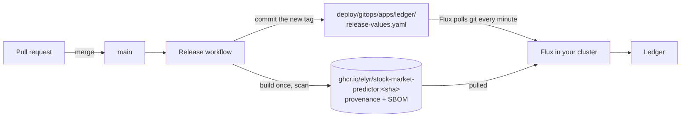

# Releases and GitOps

How a change gets from a merged pull request to a running cluster, and how to
publish a version.



## What runs on each change

| Event | Release workflow (`.github/workflows/release.yml`) |
|---|---|
| Pull request | Builds the image and scans it with [Grype](https://github.com/anchore/grype). Nothing is published. |
| Merge to `main` | Builds once, scans, publishes `ghcr.io/elyr/stock-market-predictor:<sha>` and `:main` with build provenance and an SBOM, then commits the new tag to `deploy/gitops/apps/ledger/release-values.yaml` ("Deploy image … with Flux"). |
| Tag `vX.Y.Z` | Publishes the image as `:X.Y.Z` and `:X.Y`, the Helm chart as `oci://ghcr.io/elyr/charts/ledger`, and a GitHub release with that version's notes from `CHANGELOG.md`. |

The scan fails the build on **critical** vulnerabilities that have a fix, and
reports the rest on the run's summary page and under the repository's
Security → Code scanning.

The image is built once and the same bytes are what runs: the cluster deploys
the tag CI published, it never rebuilds.

## GitOps with Flux

```bash
./kube.sh up --gitops
```

This installs Flux in the local cluster and points it at this repository.
From then on **git is the source of truth**:

- Flux applies `deploy/gitops/apps/ledger/`: a `HelmRelease` that deploys the
  chart from `deploy/helm/ledger` at the latest commit, with the image tag from
  `release-values.yaml`.
- After each merge, the Release workflow publishes an image and commits its
  tag; Flux sees the commit within a minute or two and upgrades the release.
  No `kube.sh` run needed.
- **Roll back** by reverting the "Deploy image …" commit (or any change to the
  chart): Flux applies the previous state.
- This cluster's own settings (profile, demo or live, ports, monitoring) are
  kept in two ConfigMaps that `kube.sh` writes (`ledger-profile`,
  `ledger-local` in `flux-system`); they are merged after the values from git.

```bash
alias flux='flux --context k3d-ledger'
flux get all -n flux-system               # source, kustomization, helm release and their revision
flux reconcile kustomization ledger --with-source   # check git now instead of waiting
flux logs --level=error                   # why something did not apply
flux suspend helmrelease ledger -n flux-system      # pause deployments; resume to continue
```

Other modes:

| Command | What it does |
|---|---|
| `./kube.sh up --gitops --build` | Flux deploys the chart from git, but with an image built here. Useful to try a change before pushing it. |
| `./kube.sh up --gitops --branch NAME` | Follow another branch, for example a pull request's. |
| `./kube.sh up --no-gitops` | Back to deploying with Helm from this folder. The data volumes are kept. |

`./kube.sh status` shows Flux's state when GitOps is on, and `./kube.sh down`
removes the Flux objects too, so Flux does not reinstall the app.

### Access to the image

Images in GHCR are private when first published. Either make the package
public once (GitHub → your profile → Packages → `stock-market-predictor` →
Package settings → Change visibility), or give the cluster a token that can
read packages:

```bash
GHCR_TOKEN=<a token with read:packages> GHCR_USER=<your GitHub user> ./kube.sh up --gitops
```

`kube.sh` stores it as the `ghcr-pull` secret and the chart uses it as an
`imagePullSecret`.

## Publishing a version

1. Move the notes under **Unreleased** in `CHANGELOG.md` to a new section
   `## [X.Y.Z] - YYYY-MM-DD`, and add the compare link at the bottom.
2. Merge that change.
3. Tag the merge commit and push the tag:

   ```bash
   git checkout main && git pull
   git tag -a vX.Y.Z -m "vX.Y.Z"
   git push origin vX.Y.Z
   ```

4. The Release workflow publishes the image, the chart and the GitHub release.

Install a published chart anywhere:

```bash
helm install ledger oci://ghcr.io/elyr/charts/ledger --version X.Y.Z -n ledger --create-namespace
```

Versions follow [Semantic Versioning](https://semver.org/): a new major
version for changes that need action when upgrading (settings, data), a minor
version for features, a patch version for fixes.
