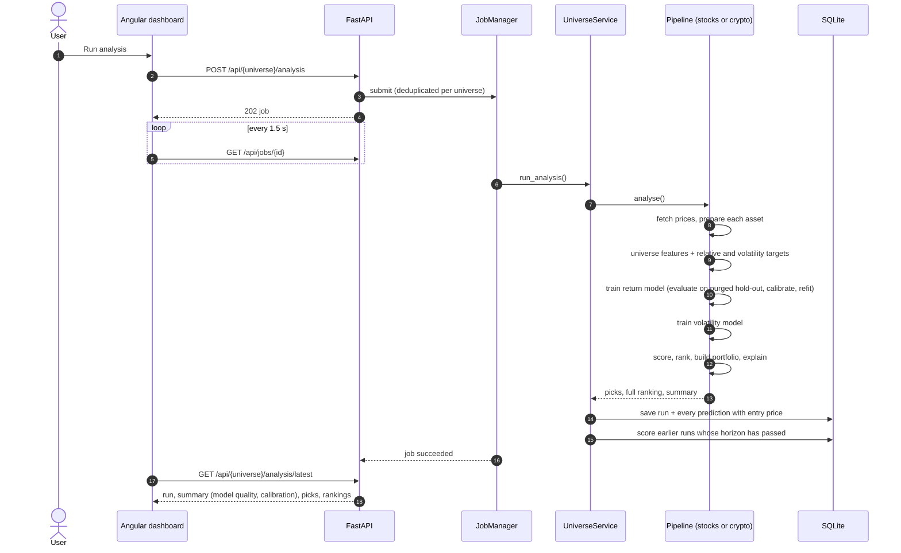
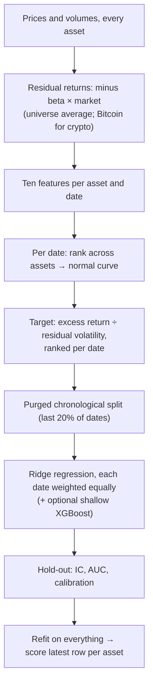

# Analysis: pipelines, features, scoring and models

How one analysis is computed, from prices to a ranking. Part of the [architecture](../ARCHITECTURE.md); section numbers (§) are unchanged and indexed in the architecture.

## 4. Two pipelines: stocks and crypto

`AssetRanker` holds everything shared. `StockPipeline` and `CryptoPipeline`
subclass it, and `create_pipeline(universe)` returns the right one. Each
instance owns its own `ReturnPredictor` and `VolatilityForecaster`, saves its
models to its own file (`data/models/{universe}.joblib`), and writes its own
runs to the database, so nothing learned on one asset class affects the other.

| | Stocks | Crypto |
|---|---|---|
| Universe | ~100 liquid S&P 500 names | 22 major coins (`BTC-USD`, …) |
| Calendar | trading days, 252 per year | every day, 365 per year |
| Extra features | return vs. the average stock (5d, 20d), 20-day return rank | return vs. Bitcoin (5d, 20d), 30-day beta and correlation to Bitcoin, Bitcoin's own 5-day return |
| Grouping | sector (Yahoo Finance) | category (store of value, smart-contract platform, payments, DeFi, …) |
| Portfolio | max 3 per sector, inverse-volatility weights | no category cap, inverse-volatility weights |
| Filters | price ≥ $5, ≥ 1M shares/day, cap ≥ $1B | ≥ $10M/day volume, cap ≥ $1B; any price |
| Market header | S&P 500, Nasdaq, Dow, VIX, gold, bonds | BTC, ETH, SOL |
| Suggested cost | 5 bp per trade | 10–20 bp per trade |

Both share the indicator set, the scoring rules, the model architecture and the
backtest engine, which keeps results comparable and the code small.

---

## 5. Analysis flow

Jobs run on a two-thread pool with one lock per universe: a stock job and a
crypto job run in parallel; two jobs on the same universe queue. Starting an
analysis that is already running returns the existing job.

---

## 6. Feature pipeline and targets

`prepare_symbol_data` runs per asset; `prepare_universe` then adds features and
targets that need the whole universe.

| Stage | Adds |
|---|---|
| Clean | drop duplicate dates, forward-fill gaps (never back-fill), repair >50% one-day spikes, fix non-positive volume |
| Basic features | returns, 5/20/60-day volatility, short/long volatility ratio, absolute return, range, volume ratio, gaps |
| Moving averages | SMA/EMA 5–200, price vs. average, distance from average, crosses |
| Momentum | rate of change 1/5/10/20 days, Williams %R, CCI |
| Candles | body and shadows, doji, hammer, engulfing, streaks |
| Support/resistance | 20-day range, distances, breakouts |
| Indicators | RSI, MACD, Bollinger, Stochastic, MFI, ATR, OBV, ADX, `*_Pct` scale-free versions, chart patterns (latest row only) |
| Targets | `Future_Return` over *h* days, `Target_Up`; `Future_Vol` and `Target_Vol_Up` over 5 days |
| Universe | `Future_Excess` and `Target_Up_Rel` (return minus the equal-weight universe average), market volatility and return, asset-class features (§4) |
| Cross-section | the return model's ten ranked `XS_*` features and its `Target_XS` target (§8) |

**Why a relative target.** On any given day most stocks move with the market,
and no stock-level feature predicts the market. Subtracting the universe average
removes that unpredictable common move and leaves exactly what a ranking can
exploit. It also makes the classes balanced (about half beat the average).

**Causality.** Every feature at date *t* uses data up to *t*. Targets look
forward and are excluded from features by name; the "scramble the future" test
(§16) enforces this end to end.

---

## 7. Scoring and portfolio construction

Each asset gets component scores on 0–100:

| Component | Default weight | How |
|---|---|---|
| Model | 1.0 | cross-sectional percentile of the return model's score (best asset = 100) |
| Technical | 0 | rules on RSI, MACD, Bollinger position, moving averages, volume, chart patterns |
| Momentum | 0 | weighted rate of change, volatility and up-day streaks |
| Volume | 0 | volume vs. average, volume trend, price–volume agreement, OBV trend |

**Why the model alone.** The hand-made scores were the original design, with
fixed weights 0.25 / 0.35 / 0.20 / 0.10 / 0.10 (the last one for a news
sentiment score, removed because it could not be backtested: see
[ADR 1](../adr/0001-remove-sentiment.md)). Measured on the demo market,
whose only signal is a planted short-term reversal, the momentum score pointed
the wrong way (its largest input rewards yesterday's rise; IC −0.075), the
technical score mixed reversal rules (RSI, Bollinger) with trend rules (MACD,
moving averages), and the fixed weights averaged a positive and a negative
signal into an IC of 0.009. The return model (§8) now sees the picks behind
those scores as features and learns from history which way each points and how
much it is worth. The component scores are still computed and shown as
plain-language explanations, and experiments can give them weight again.

The model score is a percentile rather than a probability because
probabilities for relative returns cluster near 50%; ranking spreads the score
across 0–100. Ranking uses the model's raw score, never the calibrated
probability, so calibration cannot reorder assets.

The **composite** is a weighted average over the components that exist,
renormalised so a missing component (the model score before it is trained)
does not drag scores down.

**Portfolio** (`select_portfolio`): take assets in composite order, skipping any
that would exceed the per-sector cap, until *N* are chosen; then weight them in
proportion to 1 / volatility so each contributes similar risk.

**Explanations.** For each asset the API returns the plain-language signals
(e.g. "RSI 27: oversold") and the model's contribution per feature (ridge
weight × the asset's ranked value), so the dashboard can show what pushed a
score up or down.

---

## 8. Return model

`src/models/cross_section.py`, selected by `ml_config.model: cross_section`
(the default). `legacy` keeps the earlier classifier ensemble, described at
the end of this section.

**Residual returns.** Each asset's daily log return minus its 120-day beta times
the market's return. The market's move is shared by every asset, so no asset's
history can rank it; what is left is the part a ranking can use.

**Features.** Each one is a known effect with a reason to exist, not one of
dozens of overlapping indicators:

| Feature | Formula (data up to *t*) | Why |
|---|---|---|
| `rev_1d` | −residual return today ÷ σ₆₀ | short-term overreaction reverses |
| `rev_5d` | −5-day residual return ÷ (σ₆₀ √5) | weekly reversal |
| `mom_12_1` (stocks) | log(P[t−21] ÷ P[t−252]) | 12-month momentum, skipping the last month |
| `mom_30`, `mom_90` (crypto) | log(P[t] ÷ P[t−30]), log(P[t] ÷ P[t−90]) | crypto trends over weeks |
| `low_vol` | −60-day volatility | low-volatility anomaly |
| `low_beta` | −120-day beta | betting against beta |
| `z_ma20` | −(P ÷ 20-day mean − 1) ÷ (σ₂₀ √20) | stretched prices pull back |
| `high52` | P ÷ 1-year high | anchoring to the 52-week high |
| `max_ret` | −largest daily return over 21 days | lottery-like assets disappoint |
| `vol_shock` | log(volume ÷ 20-day mean) | attention and news |
| `rev_x_vol` | `rev_1d` × −`vol_shock` | quiet moves reverse more than loud ones |

σ₆₀ is the 60-day volatility of residual returns.

**Per-date ranks.** On each date every feature becomes its rank among the
assets, mapped onto a standard normal curve (clipped at 1% and 99%); missing
values are 0, the average. The model therefore compares assets with each other
rather than with the past, is unaffected by calm versus turbulent periods, and
is not pulled around by outliers. Features are stored on the prepared frames
as `XS_*` columns, so a single row can be scored on its own.

**Target.** Return over *h* days minus the universe average, divided by
σ₆₀ √h, ranked per date onto the normal curve (`Target_XS`). It is a regression
on the size of the outperformance, so a large win teaches more than a coin flip
around zero, and volatile assets do not dominate.

**Model.** Ridge regression with strong shrinkage (α = 1000), each date weighted
equally. Its ten signed weights are readable: they say which effects history
rewarded. An optional XGBoost regressor (depth 2, 300 trees, learning rate
0.03, at least 200 samples per leaf) can run beside it as a challenger; their
scores are averaged when enabled.

**Evaluation and calibration.** The last 20% of dates, after a purge gap of *h*
dates, are held out. The IC is the Spearman correlation between the score and
the realised excess return across assets on each hold-out date. A logistic
calibrator fitted on the hold-out turns the score into the probability of
beating the universe; it sits near 50–55%, which is honest for this problem.
The models used for today are then refit on every date.

**Counting evidence honestly.** The IC is measured on every hold-out date, but
outcomes over *h* days overlap from one day to the next. So *n* daily ICs carry
only about *n / h* independent observations. The t-statistic uses that
effective count (`information_coefficient(…, overlap=h)`), and the evidence
meter's luck band does too. Counting every day as independent would overstate
the evidence by about √5 at a 5-day horizon and √21 at a month.

**Long-term model.** Each analysis also trains a second model on the same `XS_*`
features with a target about a month ahead: `long_term_horizon`, 21 trading
days for stocks and 30 days for crypto. Its targets are `Target_XS_L`,
`Future_Excess_L` and `Target_Up_Rel_L`, which are excluded from every feature
list. It has its own out-of-sample evidence and learned weights.
- **Where it shows:** the **Long-term** page and one sentence of the weekly brief.
- **What it does not do:** feed the short-term score or the portfolio picks.
- **How it is tested:** the synthetic market can plant a slow signal (a
  persistent per-asset drift, `alpha`), which the long-term model must find.
  It must find nothing when `alpha` is 0.

**Measured on the demo market** (40 assets, 5 years, planted reversal of 20%):

| | Out-of-sample IC | Backtest, excess per 5 days after costs |
|---|---|---|
| Earlier composite (hand-made scores + legacy ensemble) | 0.009 | ≈ 0 |
| Cross-sectional model | 0.076 (t 3.5) | +39 bp (t 3.2) |
| Same model, market with no signal | ≈ 0 | — |

On real markets the effects are far weaker; an IC of 0.02–0.04 would be good.

**Legacy model** (`ml_config.model: legacy`): Random Forest, XGBoost and an MLP
classifying "beats the universe" on ~86 pooled, scale-free indicators, with
`TimeSeriesSplit(gap=h)` cross-validation, Platt calibration and SHAP
explanations. On the demo market it overfit (62–65% training accuracy, 50% on
the hold-out) and did not find the planted signal; it is kept for comparison
in experiments.

---

## 9. Volatility model

Volatility clusters: big moves follow big moves. `VolatilityForecaster` pools the
universe and fits two gradient-boosted models on volatility features (5/20/60-day
volatility and their ratio, range, ATR, Bollinger width, recent returns, market
volatility):

- a **classifier** for "will the next 5 days' realised volatility exceed the
  trailing 20-day level?", reported as accuracy against the majority-class rate
  and AUC;
- a **regressor** for log future volatility, reported as R² against the naive
  forecast "volatility stays at its 20-day level".

Both are evaluated on a purged chronological hold-out, then refit. On real data
this kind of model typically reaches 65–75% accuracy, which is honest skill
rather than an artefact. On the synthetic demo market it reaches about 60%.
