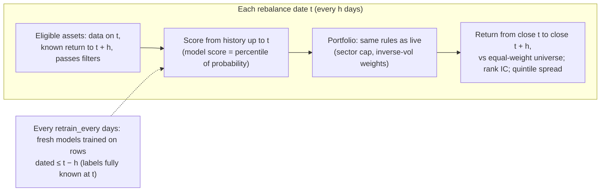
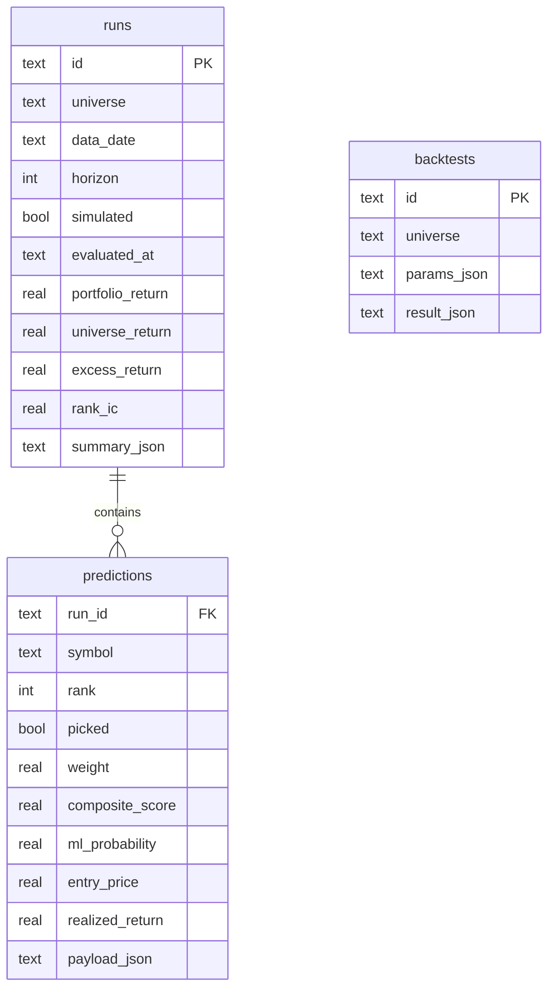
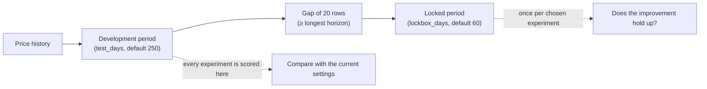

# Evaluation: backtest, track record, predicted vs actual

How Ledger measures whether its scores work. Part of the [architecture](../ARCHITECTURE.md); section numbers (§) are unchanged and indexed in the architecture.

## 10. Backtest design

- **Holding periods** are non-overlapping blocks of *h* days, annualised with
  `periods_per_year / h` (252 for stocks, 365 for crypto).
- **Costs** are charged on actual weight changes: Σ|w_new − w_old| × cost.
- **Attribution.** Alongside the composite, the top *N* by each component alone
  (technical, momentum, volume, model), to show which parts carry signal.
- **Metrics.** Total and annualised return, volatility, Sharpe, maximum drawdown,
  average excess per period, excess t-statistic, share of periods beating the
  universe; and per score: mean rank IC, t-statistic, share positive, annualised
  information ratio.
- **Market sensitivity and return beyond market risk.** A strategy that is
  simply more exposed to a rising market beats the universe without any skill, so
  each strategy's period returns are also regressed on the equal-weight
  universe's (`regress_on_universe`): `return = alpha + beta × universe return +
  error`. *Beta* (market sensitivity) says how strongly it moves with the
  universe; *alpha per year* (return beyond market risk) is what is left, with
  its own t-statistic. The holding periods do not overlap (one rebalance per
  horizon), so the plain t-statistic applies. The universe itself has beta 1 and
  no alpha. Both are columns on the Backtest page.

---

## 11. Track record

Every API analysis stores the full ranking with entry prices before the outcome
exists. `evaluate_outcomes` runs after each analysis (and on demand): for every
run whose horizon has passed it computes each asset's realised return from its
own price history, then the portfolio's return, the universe average, the excess
and the rank IC. The Track record page summarises these with a t-statistic and a
cumulative chart.

**One run per price date.** Running the analysis several times on the same
prices stores several runs that predict the same week. Only the latest run for
each price date is scored and counted. Earlier runs are kept, but marked
*superseded*, and never scored. Without this, one week would count several times
and the t-statistic would overstate the evidence.

In demo mode, a fresh database is seeded with a walk-forward backtest whose
periods are stored as **simulated** runs and always labelled as such; they never
appear as live predictions.

---

## 11b. Predicted vs actual and experiments

**Prediction log.** Every backtest now records every scored asset on every
decision date (not only the picks): its scores, the model's probability,
whether it was picked, and its actual return and excess over the universe.
Live predictions produce the same log once their horizon has passed.

**Comparator** (`build_report`), shown on the *Predicted vs actual* page:

| View | What it answers |
|---|---|
| Deciles | Ranked within each date, do higher scores go with better results? A staircase means skill. |
| Components | Rank IC of the composite and of each part (model, technical, momentum, volume): which parts help and which point the wrong way |
| IC over time | Is skill steady, fading, or confined to some periods? (per-date IC and rolling average) |
| Calibration | Do stated probabilities come true at that rate? |
| Breakdowns | Skill by sector or coin category, by market mood (volatility terciles) and by market direction |
| Log | Every prediction next to its outcome; full CSV export |

**Experiments.** An experiment changes whitelisted settings (score weights,
horizon, target, model depth and size, which models run, position sizing,
sector cap, number of picks) and replays the walk-forward backtest. Settings
are validated against `ALLOWED_SETTINGS`; anything else is rejected.

- Windows are anchored to the price calendar, so every experiment, whatever
  its horizon, is judged on exactly the same dates.
- No development decision has an outcome inside the locked period (the gap is
  at least the longest allowed horizon).
- A locked-period check runs once per experiment and is then only read back,
  so it cannot be repeated until it looks good. The page shows how many
  experiments have used the locked period, because each look makes it a
  little less independent.
