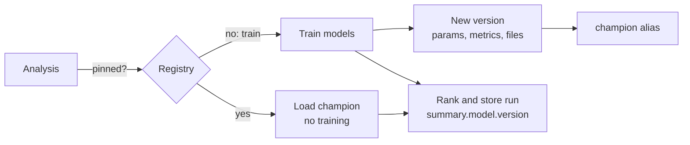
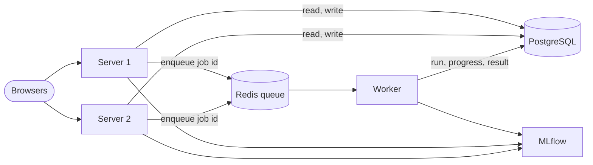

# Operations: registry, monitoring, database, jobs, data and deployment

How Ledger is run. Part of the [architecture](../ARCHITECTURE.md); section numbers (§) are unchanged and indexed in the architecture.

## 11c. Model registry

Every analysis that trains models records them in **MLflow**
(`src/models/registry.py`), so each prediction can be traced to the exact
model that made it.

- **One registered model per universe**: `ledger-stocks` and `ledger-crypto`,
  with `-demo` added for simulated data, so demo and real models never mix.
- **Each version** is an MLflow run with the settings as parameters (horizon,
  target, models, weights, number of assets and features, data date), the
  out-of-sample scores as metrics (`quality.ic_mean`, `quality.ic_t_stat`,
  `quality.test_auc`, Brier scores, volatility scores), the git commit as a
  tag, and the model files (`models.joblib`: return models, scalers,
  calibrator, volatility models and their test scores) as the `model` artifact.
- **Champion and pinning.** By default each analysis trains, registers a new
  version and moves the `champion` alias to it. Promoting a version (to roll
  back, for example) moves the alias and sets the registered model's `pinned`
  tag: analyses then load the champion and rank with it without training,
  until it is unpinned. An analysis that was training when a version got
  pinned registers its models without promoting them.
- **Old evidence.** Versions registered before the t-statistic counted
  independent periods have no `ic_independent_periods`. When one is loaded,
  and on the Models page, `correct_overlap` divides its t-statistic by
  √horizon and adds that count, so a pinned old model is judged like a new one.
- **Traceability.** Each stored run's summary has `model: {version, reused,
  registry, run_id}`; the Outlook page shows it and links to the Models page.
- **Safety.** Loaded models check that every feature they need still exists
  (settings may have changed since they were trained) and that they belong to
  the same universe. A registry outage does not fail an analysis: the run is
  stored with `model.error` and the models are simply not registered.
- **Where it lives.** `MLFLOW_TRACKING_URI` selects the store. Without it, a
  SQLite file and an artifact folder next to the app's database are used
  (`data/mlflow-demo.db`, `data/mlartifacts-demo/`). On Kubernetes the chart
  runs an MLflow server with its own volume and web UI. `MODEL_REGISTRY=off`
  turns the registry off. Only the light `mlflow-skinny` client is installed
  in the app.

Backtests and experiments train many short-lived models to measure a setting;
those are not registered, since they are not used for live predictions.

## 11d. Monitoring

`GET /metrics` serves Prometheus metrics (`api/metrics.py`), each app on its
own registry:

- **Service**: requests and latency per route template (not per URL, so the
  number of series stays small), jobs by kind, universe and outcome, job
  durations, jobs running, the time each kind last succeeded, alerts published.
- **Data and models**, computed from the database when Prometheus scrapes, so
  they are right straight after a restart: price data age, the latest model's
  rank IC and t-statistic, the rank IC of the last 15 scored live analyses, and
  the registry's champion version and pinning.

On Kubernetes, `--monitoring` deploys Prometheus with alert rules (unit-tested
with `promtool`) and Grafana with a provisioned dashboard; see
[KUBERNETES.md](../KUBERNETES.md#monitoring). `LOG_FORMAT=json` writes the
server's and uvicorn's logs as one JSON object per line, with job ids and
durations as fields.

---

## 11e. Database, jobs and scaling out

The app runs in one of two shapes, chosen by environment variables:

| | One process (default) | Scaled out |
|---|---|---|
| Database | SQLite file (`DATABASE_PATH`) | PostgreSQL (`DATABASE_URL`) |
| Jobs | Threads in the server (`JOB_QUEUE=inline`) | Redis queue and worker processes (`JOB_QUEUE=redis`, `python -m api.worker`) |
| Model registry | Local MLflow store next to the database | MLflow server (shared) |
| Server copies | 1 | any number |

- **Schema** (`api/db.py`): one SQLAlchemy Core definition for both databases,
  changed only through Alembic migrations (`api/migrations`). Each process
  migrates at startup; on PostgreSQL an advisory lock lets one process do it
  while the others wait. Databases created before migrations existed are
  adopted as they are.
- **Jobs are rows** (`jobs` table): kind, universe, JSON parameters, status,
  progress message, result, error, worker. The server inserts the row and, with
  Redis, enqueues only its id; any server copy can then report on it. A
  partial unique index on `(kind, universe)` for queued and running jobs keeps
  two copies of the same job from being queued, even by two servers at once.
- **Tasks by name** (`api/tasks.py`): `analysis`, `scan`, `seed`, `backtest`,
  `evaluate`, `experiment`, `lockbox`. The worker looks the name up and calls
  the universe's service, which is kept in memory between jobs (RQ's
  `SimpleWorker`, no fork per job).
- **Order per universe**: a thread lock inline, a Redis lock with workers, so
  jobs of one universe run one after the other while stocks and crypto run
  side by side.
- **Failure handling**: inline jobs interrupted by a restart are marked failed
  at the next start. With Redis, a job whose queue entry is gone or failed
  (worker killed, Redis restarted) is marked failed the next time it is looked
  at, so it never blocks new jobs. Redis holds nothing else, so it needs no
  persistence.
- **Moving between databases**: the backup script copies a database by URL table
  by table, and restores into either kind, so a SQLite backup can be loaded
  into PostgreSQL and the other way round (`./kube.sh up --postgres` does this).

---

## 14. Data sources, demo mode and deployment

**Yahoo Finance via `yfinance`** is the only required source: prices for stocks
and coins (`BTC-USD`), company info, news and index levels. The collector rate
limits (default 0.5 s between requests), retries with backoff, caches price
history for 15 minutes and company info per process, and normalises dates to a
timezone-free calendar.

**Fallback sources** (`src/data/providers.py`). When Yahoo Finance returns
nothing for a symbol after its retries, the collector asks the next provider
that supports the symbol; the first one that returns prices wins. The usual
history filters then apply as for any series:

| Provider | Symbols | Key | Notes |
|---|---|---|---|
| Coinbase Exchange | `*-USD` coins | none | public daily candles, 300 days per request, paged |
| Alpha Vantage | stocks | `ALPHA_VANTAGE_API_KEY` | free tier about 25 requests a day: a few symbols, not a universe |

Every provider returns the same frame as Yahoo Finance. The collector counts
where each series came from (`run_sources`, reset at each analysis, saved in the
analysis summary as `data_sources`) and every failure per source. `/metrics`
exports them as `ledger_price_series_fetched_total` and
`ledger_price_source_failures_total` (labels `universe`, `source`), and the
Outlook page says when part of an analysis came from a backup source.
`api_config.fallback: false` turns the fallback off. Closes can differ slightly
between sources (Coinbase closes at midnight UTC; Yahoo's crypto day is also UTC,
so the two agree closely).

**Demo mode** (`DEMO_MODE=true`, or `--demo` on the CLI) swaps in the synthetic
market: one-factor returns with GARCH volatility clustering and a mild planted
mean-reversion signal; crypto symbols get a 7-day calendar and higher volatility
around a Bitcoin-driven factor. It needs no network, is deterministic, and seeds
both dashboards on first start. Its numbers say nothing about real markets.

**Deployment.** The `Dockerfile` builds the Angular app in a Node stage and runs
it from the FastAPI server in a Python stage; `docker compose up --build` starts
it on port 8000 with a volume for the database and saved models. Any host that
runs a container works (Render, Railway, Fly.io, Hugging Face Spaces, a VM).
Hosted servers are often throttled by Yahoo Finance, so demo mode is the
reliable choice for a public demo.

**Kubernetes.** The Helm chart in `deploy/helm/ledger` runs the same image as a
single-replica Deployment with persistent volumes, an Ingress, health probes
(`/api/health`, `/api/ready`) and CronJobs for the alert scans and the daily
prediction, plus an MLflow server for the model registry. The scan jobs call the server's API (`scripts/k8s_trigger.py`)
rather than opening the database, and the server's own scheduler is turned off
(`INTERNAL_SCHEDULER=false`). `./kube.sh up` deploys it to a local k3d cluster.
Backups (`scripts/backup.py`, standard library only) copy each SQLite
database with SQLite's online backup and each folder file by file into one
archive with a checksummed manifest; a restore verifies everything before it
replaces anything. See [KUBERNETES.md](../KUBERNETES.md).
